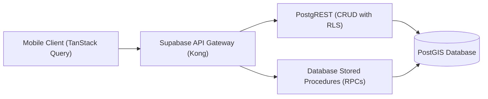

# NearBites — API Contracts & RPC Interface Specification

> **Document Status**: CANONICAL API SPECIFICATION (Baseline v1.0)  
> **API Protocol**: Supabase PostgREST & Database RPC Functions over HTTPS  
> **Response Format**: JSON with standardized envelopes  
> **Execution SLA**: Viewport Bounding Box queries `< 80ms` (database tier) / `< 300ms` (client perceived)

---

## Table of Contents

1. [API Architecture Overview](#1-api-architecture-overview)
2. [Core RPC Function Contracts](#2-core-rpc-function-contracts)
   - [RPC 1: `get_viewport_meals`](#rpc-1-get_viewport_meals)
   - [RPC 2: `get_meal_details`](#rpc-2-get_meal_details)
   - [RPC 3: `confirm_meal_price`](#rpc-3-confirm_meal_price)
   - [RPC 4: `submit_price_correction`](#rpc-4-submit_price_correction)
   - [RPC 5: `search_food_and_places`](#rpc-5-search_food_and_places)
3. [Error Handling & Status Code Taxonomy](#3-error-handling--status-code-taxonomy)
4. [TanStack Query Key Conventions & Cache Rules](#4-tanstack-query-key-conventions--cache-rules)

---

## 1. API Architecture Overview

NearBites connects to Supabase via the official `@supabase/supabase-js` client SDK. Complex spatial queries and transactional multi-table updates are executed through PostgreSQL Stored Procedures (RPCs). Simple entity reads and inserts utilize PostgREST endpoints governed by active Row Level Security (RLS) policies.



---

## 2. Core RPC Function Contracts

### RPC 1: `get_viewport_meals`

Fetches lightweight meal markers within the current map bounding box matching budget and category constraints.

- **Endpoint**: `POST /rest/v1/rpc/get_viewport_meals`
- **Access Level**: Public / Anonymous
- **SLA**: `< 80ms` execution time on database tier.

#### Request Parameters (JSON)
```json
{
  "min_lat": 14.5900,
  "min_lng": 120.9800,
  "max_lat": 14.6150,
  "max_lng": 121.0000,
  "max_budget": 150.00,
  "category_filter": null
}
```

#### TypeScript Request Interface
```typescript
export interface GetViewportMealsParams {
  min_lat: number;
  min_lng: number;
  max_lat: number;
  max_lng: number;
  max_budget?: number;       // 0 or null = no budget ceiling
  category_filter?: string | null;
}
```

#### Response Payload (JSON)
```json
[
  {
    "id": "e4a2d3b1-7f8e-4a9b-9c1d-3e5f7a9b1c3d",
    "meal_id": "e4a2d3b1-7f8e-4a9b-9c1d-3e5f7a9b1c3d",
    "restaurant_id": "a0000001-0000-0000-0000-000000000001",
    "title": "Crispy Pork Sisig w/ Rice",
    "price": 99.00,
    "latitude": 14.5995,
    "longitude": 120.9842,
    "thumbnail_url": "https://images.unsplash.com/photo-1626777552726-4a6b54c97e46?w=200&q=75",
    "freshness_tier": "fresh"
  }
]
```

#### TypeScript Response Type
```typescript
export interface MealMarkerResponse {
  id: string;
  meal_id: string;
  restaurant_id: string;
  title: string;
  price: number;
  latitude: number;
  longitude: number;
  thumbnail_url: string;
  freshness_tier: 'fresh' | 'aging' | 'stale';
}
```

---

### RPC 2: `get_meal_details`

Fetches exhaustive dish and venue details for the bottom sheet when expanded, calculating walking distance relative to the user's current coordinates.

- **Endpoint**: `POST /rest/v1/rpc/get_meal_details`
- **Access Level**: Public / Anonymous

#### PostgreSQL RPC Definition
```sql
CREATE OR REPLACE FUNCTION public.get_meal_details(
    p_meal_id UUID,
    p_user_lat DOUBLE PRECISION DEFAULT NULL,
    p_user_lng DOUBLE PRECISION DEFAULT NULL
)
RETURNS JSONB
LANGUAGE plpgsql
STABLE
AS $$
DECLARE
    result JSONB;
BEGIN
    SELECT jsonb_build_object(
        'meal', jsonb_build_object(
            'id', m.id,
            'title', m.title,
            'description', m.description,
            'price', m.current_price,
            'category', m.category,
            'hero_photo_url', m.hero_photo_url,
            'last_confirmed_at', m.last_confirmed_at,
            'freshness_tier', CASE
                WHEN m.last_confirmed_at >= (NOW() - INTERVAL '30 days') THEN 'fresh'
                WHEN m.last_confirmed_at >= (NOW() - INTERVAL '90 days') THEN 'aging'
                ELSE 'stale'
            END,
            'additional_photos', COALESCE((
                SELECT jsonb_agg(photo_url)
                FROM public.meal_photos
                WHERE meal_id = m.id AND moderation_status = 'approved'
            ), '[]'::jsonb)
        ),
        'restaurant', jsonb_build_object(
            'id', r.id,
            'name', r.name,
            'address', r.address,
            'latitude', ST_Y(r.location::geometry),
            'longitude', ST_X(r.location::geometry),
            'opening_hours', r.opening_hours,
            'is_verified', r.is_verified,
            'distance_meters', CASE 
                WHEN p_user_lat IS NOT NULL AND p_user_lng IS NOT NULL THEN
                    ROUND(ST_Distance(r.location, ST_SetSRID(ST_MakePoint(p_user_lng, p_user_lat), 4326)::geography))
                ELSE NULL
            END
        ),
        'other_meals', COALESCE((
            SELECT jsonb_agg(jsonb_build_object(
                'id', om.id,
                'title', om.title,
                'price', om.current_price,
                'photo_url', om.hero_photo_url
            ))
            FROM public.meals om
            WHERE om.restaurant_id = r.id 
              AND om.id != m.id 
              AND om.moderation_status = 'approved'
            LIMIT 5
        ), '[]'::jsonb)
    ) INTO result
    FROM public.meals m
    JOIN public.restaurants r ON m.restaurant_id = r.id
    WHERE m.id = p_meal_id;

    RETURN result;
END;
$$;
```

#### TypeScript Response Interface
```typescript
export interface MealDetailsResponse {
  meal: {
    id: string;
    title: string;
    description: string;
    price: number;
    category: string;
    hero_photo_url: string;
    last_confirmed_at: string;
    freshness_tier: 'fresh' | 'aging' | 'stale';
    additional_photos: string[];
  };
  restaurant: {
    id: string;
    name: string;
    address: string;
    latitude: number;
    longitude: number;
    opening_hours: Record<string, { open: string; close: string; closed: boolean }>;
    is_verified: boolean;
    distance_meters: number | null;
  };
  other_meals: Array<{
    id: string;
    title: string;
    price: number;
    photo_url: string;
  }>;
}
```

---

### RPC 3: `confirm_meal_price`

Allows an authenticated user to verify that a meal's price is currently accurate.

- **Endpoint**: `POST /rest/v1/rpc/confirm_meal_price`
- **Access Level**: Protected (Authenticated User)

#### PostgreSQL RPC Definition
```sql
CREATE OR REPLACE FUNCTION public.confirm_meal_price(
    p_meal_id UUID
)
RETURNS JSONB
LANGUAGE plpgsql
SECURITY DEFINER
AS $$
DECLARE
    v_user_id UUID := auth.uid();
BEGIN
    IF v_user_id IS NULL THEN
        RAISE EXCEPTION 'Authentication required' USING ERRCODE = 'NB401';
    END IF;

    -- Record confirmation event
    INSERT INTO public.price_confirmations (meal_id, user_id, confirmed_at)
    VALUES (p_meal_id, v_user_id, NOW());

    -- Update meal entity last_confirmed_at
    UPDATE public.meals
    SET last_confirmed_at = NOW(),
        updated_at = NOW()
    WHERE id = p_meal_id;

    RETURN jsonb_build_object(
        'success', true,
        'meal_id', p_meal_id,
        'last_confirmed_at', NOW()
    );
END;
$$;
```

---

### RPC 4: `submit_price_correction`

Submits an updated price proposal with optional receipt photo. Staged for moderation review without overwriting existing price.

- **Endpoint**: `POST /rest/v1/rpc/submit_price_correction`
- **Access Level**: Protected (Authenticated User)

#### PostgreSQL RPC Definition
```sql
CREATE OR REPLACE FUNCTION public.submit_price_correction(
    p_meal_id UUID,
    p_new_price NUMERIC,
    p_receipt_photo_url TEXT DEFAULT NULL
)
RETURNS JSONB
LANGUAGE plpgsql
SECURITY DEFINER
AS $$
DECLARE
    v_user_id UUID := auth.uid();
    v_old_price NUMERIC;
BEGIN
    IF v_user_id IS NULL THEN
        RAISE EXCEPTION 'Authentication required' USING ERRCODE = 'NB401';
    END IF;

    IF p_new_price <= 0 THEN
        RAISE EXCEPTION 'Price must be greater than 0' USING ERRCODE = 'NB400';
    END IF;

    SELECT current_price INTO v_old_price
    FROM public.meals
    WHERE id = p_meal_id;

    IF v_old_price IS NULL THEN
        RAISE EXCEPTION 'Meal not found' USING ERRCODE = 'NB404';
    END IF;

    -- Append audit record
    INSERT INTO public.price_history (
        meal_id, old_price, new_price, submitted_by, source, receipt_photo_url
    ) VALUES (
        p_meal_id, v_old_price, p_new_price, v_user_id, 'community_correction', p_receipt_photo_url
    );

    RETURN jsonb_build_object(
        'success', true,
        'meal_id', p_meal_id,
        'old_price', v_old_price,
        'new_price', p_new_price,
        'status', 'staged_for_review'
    );
END;
$$;
```

---

### RPC 5: `search_food_and_places`

Unified search across meal titles, categories, and venue names/neighborhoods.

- **Endpoint**: `POST /rest/v1/rpc/search_food_and_places`
- **Access Level**: Public / Anonymous

#### PostgreSQL RPC Definition
```sql
CREATE OR REPLACE FUNCTION public.search_food_and_places(
    p_query TEXT,
    p_user_lat DOUBLE PRECISION DEFAULT NULL,
    p_user_lng DOUBLE PRECISION DEFAULT NULL,
    p_limit INTEGER DEFAULT 10
)
RETURNS JSONB
LANGUAGE sql
STABLE
AS $$
    SELECT jsonb_build_object(
        'dishes', COALESCE((
            SELECT jsonb_agg(jsonb_build_object(
                'id', m.id,
                'title', m.title,
                'price', m.current_price,
                'category', m.category,
                'venue_name', r.name,
                'latitude', ST_Y(r.location::geometry),
                'longitude', ST_X(r.location::geometry)
            ))
            FROM public.meals m
            JOIN public.restaurants r ON m.restaurant_id = r.id
            WHERE m.moderation_status = 'approved'
              AND (m.title ILIKE '%' || p_query || '%' OR m.category ILIKE '%' || p_query || '%')
            LIMIT p_limit
        ), '[]'::jsonb),
        'venues', COALESCE((
            SELECT jsonb_agg(jsonb_build_object(
                'id', r.id,
                'name', r.name,
                'address', r.address,
                'latitude', ST_Y(r.location::geometry),
                'longitude', ST_X(r.location::geometry)
            ))
            FROM public.restaurants r
            WHERE r.name ILIKE '%' || p_query || '%' OR r.address ILIKE '%' || p_query || '%'
            LIMIT p_limit
        ), '[]'::jsonb)
    );
$$;
```

---

## 3. Error Handling & Status Code Taxonomy

All API errors return a standard structured JSON envelope:

```json
{
  "error": {
    "code": "NB401",
    "message": "Authentication required to perform this action",
    "details": "User session is invalid or expired"
  }
}
```

| Error Code | HTTP Status | Description | Client Recovery Action |
| :---: | :---: | :--- | :--- |
| `NB400` | 400 | Validation error in payload (e.g. invalid price, coordinates out of range). | Highlight invalid field with inline message. |
| `NB401` | 401 | Protected action attempted without active session. | Trigger Progressive Auth Modal sheet. |
| `NB403` | 403 | Forbidden action (e.g. attempting to modify another user's draft). | Display permission denied toast. |
| `NB404` | 404 | Target meal or restaurant record not found. | Invalidate query cache; return to map. |
| `NB429` | 429 | Rate limit exceeded (e.g. search query spamming). | Pause requests for 2 seconds with backoff. |
| `NB500` | 500 | Internal server or PostGIS execution failure. | Display retry snackbar; report to Sentry. |

---

## 4. TanStack Query Key Conventions & Cache Rules

```typescript
// services/queryKeys.ts
export const queryKeys = {
  meals: {
    all: ['meals'] as const,
    viewport: (bounds: ViewportBounds, maxBudget: number, category?: string) =>
      ['meals', 'viewport', bounds, maxBudget, category ?? 'all'] as const,
    detail: (mealId: string) => ['meals', 'detail', mealId] as const,
  },
  restaurants: {
    detail: (restaurantId: string) => ['restaurants', 'detail', restaurantId] as const,
  },
  favorites: {
    list: (userId: string) => ['favorites', userId] as const,
  },
  search: {
    query: (text: string) => ['search', text] as const,
  },
};
```
