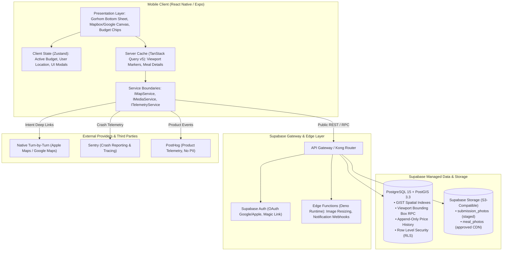
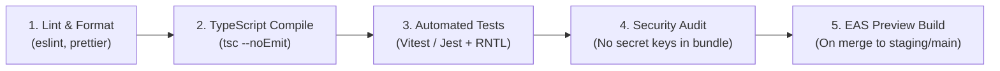

# NearBites — Technical Architecture Specification

> **Document Status**: CANONICAL TECHNICAL ARCHITECTURE (Baseline v1.0)  
> **Target Release**: Mobile MVP (iOS & Android)  
> **Platform Engine**: React Native with Expo SDK (TypeScript Strict Mode)  
> **Backend & Geospatial**: Supabase (PostgreSQL 15+ with PostGIS 3.3+, Supabase Auth, Storage, Edge Functions)  
> **Observability**: Sentry (Error & Performance) + PostHog (Product Funnel Telemetry)

---

## Table of Contents

1. [High-Level System Architecture](#1-high-level-system-architecture)
2. [Mobile Frontend Architecture](#2-mobile-frontend-architecture)
   - [Framework & Runtime](#21-framework--runtime)
   - [Expo Router File-Based Navigation](#22-expo-router-file-based-navigation)
   - [Server State Management (TanStack Query v5)](#23-server-state-management-tanstack-query-v5)
   - [Client UI State Management (Zustand)](#24-client-ui-state-management-zustand)
   - [Forms & Typed Validation (React Hook Form + Zod)](#25-forms--typed-validation-react-hook-form--zod)
   - [Gestures & Bottom Sheet Motion](#26-gestures--bottom-sheet-motion)
3. [Vendor Service Boundary Abstractions](#3-vendor-service-boundary-abstractions)
   - [Map & Geospatial Service Abstraction (`IMapService`)](#31-map--geospatial-service-abstraction-imapservice)
   - [Media & Storage Service Abstraction (`IMediaService`)](#32-media--storage-service-abstraction-imediaservice)
   - [Telemetry & Observability Facade (`ITelemetryService`)](#33-telemetry--observability-facade-itelemetryservice)
4. [Security, Privacy & Data Isolation](#4-security-privacy--data-isolation)
   - [Client Key Isolation](#41-client-key-isolation)
   - [Row Level Security (RLS) Strategy](#42-row-level-security-rls-strategy)
   - [Foreground Geolocation & Privacy Guardrails](#43-foreground-geolocation--privacy-guardrails)
   - [Content Sanitization & Upload Safety](#44-content-sanitization--upload-safety)
5. [Environments, Configuration & CI/CD Pipeline](#5-environments-configuration--cicd-pipeline)
   - [Environment Matrix](#51-environment-matrix)
   - [EAS Build Configuration Architecture](#52-eas-build-configuration-architecture)
   - [GitHub Actions CI Workflow Pipeline](#53-github-actions-ci-workflow-pipeline)

---

## 1. High-Level System Architecture

NearBites coordinates a lightweight mobile client with a PostGIS geospatial backend. The client never queries or downloads the full restaurant catalog. Instead, discovery is strictly driven by the active map camera viewport bounding box.



---

## 2. Mobile Frontend Architecture

### 2.1 Framework & Runtime

- **Runtime**: React Native `0.74+` using Expo SDK `51+` in **TypeScript Strict Mode** (`"strict": true`, `"noImplicitAny": true`).
- **Engine**: Hermes JavaScript Engine enabled on both iOS and Android for sub-second startup time and optimized memory footprint.
- **Architectural Pattern**: Feature-Sliced Modular Architecture:
  ```
  src/
  ├── app/                  # Expo Router file-based route definitions
  ├── components/           # Reusable design system primitives (Button, Chip, Card, Badge)
  ├── features/             # Domain feature modules (map, meals, budget, auth, submissions)
  │   ├── [feature]/
  │   │   ├── api/          # TanStack query hooks & Supabase RPC callers
  │   │   ├── components/   # Feature-specific UI components
  │   │   ├── hooks/        # Local state & gesture coordination hooks
  │   │   └── types/        # Strongly typed TypeScript contracts
  ├── services/             # Concrete vendor implementations & abstractions
  ├── store/                # Global client-only Zustand stores
  └── theme/                # Design tokens (colors, typography, spacing, shadows)
  ```

---

### 2.2 Expo Router File-Based Navigation

The application navigation directly mirrors the approved Information Architecture:

```
app/
├── _layout.tsx                 # Root layout: Providers (QueryClient, Auth, GestureRoot)
├── (tabs)/
│   ├── _layout.tsx             # Bottom tab bar shell (Deep Teal active tint)
│   ├── index.tsx               # Tab 1: Map Discovery Canvas (Default Route)
│   ├── saved.tsx               # Tab 2: Saved Favorites Grid (Protected Action)
│   ├── add.tsx                 # Tab 3: Community Contribution Wizard (Protected Action)
│   └── profile.tsx             # Tab 4: User Profile, History & Settings
├── (modals)/
│   ├── search.tsx              # Tripartite Autocomplete Search Overlay
│   ├── budget-slider.tsx       # Custom Budget Max-Price Modal Sheet
│   ├── auth.tsx                # Progressive Authentication Interception Sheet
│   ├── report.tsx              # Listing & Price Flagging Sheet
│   └── price-correction.tsx    # Submit Updated Price Modal
└── meal/
    └── [id].tsx                # Universal deep link fallback for shared meals
```

---

### 2.3 Server State Management (TanStack Query v5)

TanStack Query manages all asynchronous network state, caching, background invalidation, and debouncing.

#### Query Key Hierarchy & Invalidation Matrix

| Query Key Pattern | Cache TTL (`staleTime`) | GC Time (`gcTime`) | Invalidation Triggers |
| :--- | :---: | :---: | :--- |
| `['meals', 'viewport', bounds, maxBudget, category]` | 60 seconds | 5 minutes | Map camera pans/zooms beyond 20% delta; budget pill changed |
| `['meal', 'detail', mealId]` | 5 minutes | 15 minutes | Price confirmed; price correction approved |
| `['favorites', userId]` | 10 minutes | 30 minutes | Meal favorited; meal unfavorited (optimistic update) |
| `['search', query, coords]` | 30 seconds | 2 minutes | Search query input debounced at 300ms |
| `['submissions', 'user', userId]` | 2 minutes | 10 minutes | New submission completed by user |

```typescript
// features/map/api/useViewportMeals.ts
import { useQuery } from '@tanstack/react-query';
import { mapService } from '@/services/MapService';
import { ViewportBounds, MealMarker } from '@/features/map/types';

export const useViewportMeals = (bounds: ViewportBounds, maxBudget: number, category?: string) => {
  return useQuery<MealMarker[], Error>({
    queryKey: ['meals', 'viewport', bounds, maxBudget, category],
    queryFn: () => mapService.fetchViewportMarkers(bounds, maxBudget, category),
    staleTime: 60 * 1000,
    gcTime: 5 * 60 * 1000,
    enabled: Boolean(bounds.minLat && bounds.maxLat),
    refetchOnWindowFocus: false,
  });
};
```

---

### 2.4 Client UI State Management (Zustand)

Client-only transient state (filter selections, current GPS coordinate, active bottom sheet snap point) is maintained in lightweight Zustand stores:

```typescript
// store/useDiscoveryStore.ts
import { create } from 'zustand';

interface DiscoveryState {
  activeBudget: number;                // e.g., 99, 150, 250 (0 = All)
  selectedMarkerId: string | null;     // Highlighted meal ID
  bottomSheetState: 'HIDDEN' | 'PEEK' | 'EXPANDED';
  userLocation: { latitude: number; longitude: number } | null;
  hasLocationPermission: boolean;
  
  setActiveBudget: (budget: number) => void;
  setSelectedMarkerId: (id: string | null) => void;
  setBottomSheetState: (state: 'HIDDEN' | 'PEEK' | 'EXPANDED') => void;
  setUserLocation: (coords: { latitude: number; longitude: number } | null) => void;
  setHasLocationPermission: (hasPerm: boolean) => void;
}

export const useDiscoveryStore = create<DiscoveryState>((set) => ({
  activeBudget: 150, // Default MVP budget: <= ₱150
  selectedMarkerId: null,
  bottomSheetState: 'HIDDEN',
  userLocation: null,
  hasLocationPermission: false,

  setActiveBudget: (budget) => set({ activeBudget: budget }),
  setSelectedMarkerId: (id) => set({ 
    selectedMarkerId: id,
    bottomSheetState: id ? 'PEEK' : 'HIDDEN',
  }),
  setBottomSheetState: (state) => set({ bottomSheetState: state }),
  setUserLocation: (coords) => set({ userLocation: coords }),
  setHasLocationPermission: (hasPerm) => set({ hasLocationPermission: hasPerm }),
}));
```

---

### 2.5 Forms & Typed Validation (React Hook Form + Zod)

All user contributions, price updates, and report forms enforce strict client-side Zod validation before transmitting payloads:

```typescript
// features/submissions/types/submissionSchema.ts
import { z } from 'zod';

export const mealSubmissionSchema = z.object({
  restaurantId: z.string().uuid().optional(),
  newRestaurantName: z.string().min(3).max(100).optional(),
  newRestaurantAddress: z.string().min(5).max(200).optional(),
  newRestaurantLocation: z.object({
    latitude: z.number().min(-90).max(90),
    longitude: z.number().min(-180).max(180),
  }).optional(),
  title: z.string().min(3, "Dish title must be at least 3 characters").max(80),
  category: z.enum([
    'Rice Meals',
    'Noodles & Soup',
    'Silog',
    'Street Food & BBQ',
    'Snacks & Merienda',
    'Drinks & Dessert',
    'Other'
  ]),
  price: z.number().positive("Price must be greater than ₱0").max(1000, "Price exceeds MVP ceiling"),
  photoUri: z.string().url("Valid photo asset required"),
}).refine(data => data.restaurantId || (data.newRestaurantName && data.newRestaurantLocation), {
  message: "Either choose an existing restaurant or provide a new venue with coordinates",
  path: ["restaurantId"],
});

export type MealSubmissionFormValues = z.infer<typeof mealSubmissionSchema>;
```

---

### 2.6 Gestures & Bottom Sheet Motion

The map and bottom sheet coordinate via **Gorhom Bottom Sheet v4** and **React Native Reanimated 3**:

- **Snap Points**: `['200dp', '85%']` (Peek State ~200dp, Expanded State 85% screen height).
- **Physics**: Spring animation configuration with `damping: 20`, `stiffness: 150`, `mass: 0.8` guarantees bottom sheet snaps to Peek State in `< 180ms` (exceeding the 200ms NFR-03 requirement).
- **Camera Offset Synchronization**: Selecting a marker triggers a programmatic map pan with a `+80dp` latitude offset so the pin remains anchored above the Peek Bottom Sheet.

---

## 3. Vendor Service Boundary Abstractions

To prevent lock-in to specific map providers, storage CDNs, or analytics vendors, NearBites encapsulates third-party integrations behind strict TypeScript interfaces.

### 3.1 Map & Geospatial Service Abstraction (`IMapService`)

```typescript
// services/types/IMapService.ts
export interface ViewportBounds {
  minLat: number;
  minLng: number;
  maxLat: number;
  maxLng: number;
}

export interface MealMarkerPayload {
  id: string;
  mealId: string;
  restaurantId: string;
  title: string;
  price: number;
  latitude: number;
  longitude: number;
  thumbnailUrl: string;
  freshnessTier: 'fresh' | 'aging' | 'stale';
}

export interface IMapService {
  fetchViewportMarkers(
    bounds: ViewportBounds,
    maxBudget: number,
    category?: string
  ): Promise<MealMarkerPayload[]>;
  
  geocodeAddress(address: string): Promise<{ latitude: number; longitude: number; formattedAddress: string } | null>;
  
  calculateDistanceMeters(
    origin: { latitude: number; longitude: number },
    destination: { latitude: number; longitude: number }
  ): number;
}
```

---

### 3.2 Media & Storage Service Abstraction (`IMediaService`)

```typescript
// services/types/IMediaService.ts
export interface CompressedImageResult {
  uri: string;
  width: number;
  height: number;
  fileSizeBytes: number;
  mimeType: 'image/webp' | 'image/jpeg';
}

export interface IMediaService {
  /**
   * Compresses image client-side to max 1600px dimension and < 500KB file size
   */
  compressImage(sourceUri: string): Promise<CompressedImageResult>;

  /**
   * Uploads compressed photo asset to Supabase Storage bucket
   */
  uploadPhoto(
    bucket: 'submission_photos' | 'meal_photos',
    compressedImage: CompressedImageResult,
    userId: string
  ): Promise<{ publicUrl: string; storagePath: string }>;
}
```

---

### 3.3 Telemetry & Observability Facade (`ITelemetryService`)

```typescript
// services/types/ITelemetryService.ts
export interface ITelemetryService {
  init(): void;
  identify(userId: string, traits?: Record<string, unknown>): void;
  reset(): void;
  track(eventName: string, properties?: Record<string, unknown>): void;
  captureException(error: Error, context?: Record<string, unknown>): void;
  addBreadcrumb(message: string, category?: string): void;
}
```

---

## 4. Security, Privacy & Data Isolation

### 4.1 Client Key Isolation

The client bundle is strictly unprivileged:

```env
# Exposed in mobile client binary (.env.production)
EXPO_PUBLIC_SUPABASE_URL=https://[project-ref].supabase.co
EXPO_PUBLIC_SUPABASE_ANON_KEY=eyJhbGciOi... (public anon key with RLS enforcement)

# STRICTLY PROHIBITED in mobile client binary:
# SUPABASE_SERVICE_ROLE_KEY (Server-side Edge Functions only)
# SENTRY_AUTH_TOKEN (CI build step only)
# POSTHOG_PERSONAL_API_KEY (CI build step only)
```

---

### 4.2 Row Level Security (RLS) Strategy

PostgreSQL Row Level Security is active across all tables:
- **`restaurants` & `meals`**: Public read access for rows where `moderation_status = 'approved'`. Modification is restricted to admin roles.
- **`favorites`**: Users can SELECT, INSERT, and DELETE only rows where `auth.uid() = user_id`.
- **`submissions`**: Users can INSERT draft rows and SELECT their own submissions where `auth.uid() = user_id`. UPDATE and DELETE are restricted to moderation admins.
- **`price_confirmations`**: Users can INSERT confirmation rows where `auth.uid() = user_id`.

---

### 4.3 Foreground Geolocation & Privacy Guardrails

In adherence to the **Philippine Data Privacy Act of 2012 (RA 10173)** and Apple/Google store policies:
1. **Foreground-Only**: The app requests `Location.requestForegroundPermissionsAsync()`. Background location permissions (`requestBackgroundPermissionsAsync`) are **never** declared in `app.json`.
2. **Zero Coordinate Logging**: Raw GPS coordinates are never stored in telemetry, analytics events, or persistent user profiles. Coordinated analytics payloads report only relative distances (`distance_m`) or neighborhood strings.
3. **Local Pilot Fallback**: When GPS permission is denied, coordinates default to the central pilot district in memory, completely localized on the device.

---

### 4.4 Content Sanitization & Upload Safety

1. **Client-Side Image Scrubbing**: The compression pipeline strips all EXIF metadata (including geolocation tags and device serial numbers) from photos before upload.
2. **Allowed MIME Types**: Only `image/webp` and `image/jpeg` are accepted. Files exceeding `500KB` after compression are rejected.
3. **Text Sanitization**: Input fields are sanitized against control characters and cross-site scripting strings before storage insertion.

---

## 5. Environments, Configuration & CI/CD Pipeline

### 5.1 Environment Matrix

| Parameter | Development (`dev`) | Staging (`preview`) | Production (`prod`) |
| :--- | :--- | :--- | :--- |
| **Supabase Instance** | Local CLI / Dev Project | NearBites Staging Project | NearBites Production Project |
| **App Bundle ID** | `ph.nearbites.app.dev` | `ph.nearbites.app.preview` | `ph.nearbites.app` |
| **App Name** | NearBites (Dev) | NearBites (Preview) | NearBites |
| **Sentry Environment** | `development` | `staging` | `production` |
| **PostHog Host** | Local mock / disabled | PostHog Staging Project | PostHog Production Project |

---

### 5.2 EAS Build Configuration Architecture

```json
// eas.json
{
  "cli": {
    "version": ">= 10.0.0"
  },
  "build": {
    "development": {
      "developmentClient": true,
      "distribution": "internal",
      "env": {
        "APP_ENV": "development"
      }
    },
    "preview": {
      "distribution": "internal",
      "channel": "staging",
      "env": {
        "APP_ENV": "staging"
      }
    },
    "production": {
      "distribution": "store",
      "channel": "production",
      "autoIncrement": true,
      "env": {
        "APP_ENV": "production"
      }
    }
  }
}
```

---

### 5.3 GitHub Actions CI Workflow Pipeline

Every pull request and merge to `main` executes an automated 4-stage quality gate:


