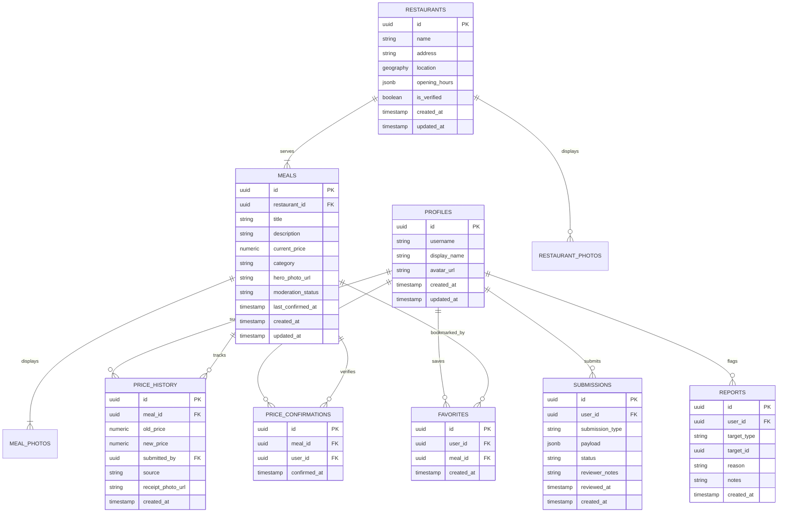

# NearBites — PostGIS Database & Data Model Specification

> **Document Status**: CANONICAL DATABASE SPECIFICATION (Baseline v1.0)  
> **Database Engine**: PostgreSQL 15+ with PostGIS 3.3+ Extension  
> **Backend Platform**: Supabase  
> **Spatial Reference System**: WGS 84 (SRID 4326) / Coordinate Standard: (Longitude, Latitude)

---

## Table of Contents

1. [Entity-Relationship Diagram (ERD)](#1-entity-relationship-diagram-erd)
2. [Core Table Schemas & PostgreSQL DDL](#2-core-table-schemas--postgresql-ddl)
   - [Extensions & Custom Types](#21-extensions--custom-types)
   - [Profiles Table (`profiles`)](#22-profiles-table-profiles)
   - [Restaurants Table (`restaurants`)](#23-restaurants-table-restaurants)
   - [Restaurant Photos Table (`restaurant_photos`)](#24-restaurant-photos-table-restaurant_photos)
   - [Meals Table (`meals`)](#25-meals-table-meals)
   - [Meal Photos Table (`meal_photos`)](#26-meal-photos-table-meal_photos)
   - [Append-Only Price History Table (`price_history`)](#27-append-only-price-history-table-price_history)
   - [Price Confirmations Table (`price_confirmations`)](#28-price-confirmations-table-price_confirmations)
   - [Favorites Table (`favorites`)](#29-favorites-table-favorites)
   - [Community Submissions Staging Table (`submissions`)](#210-community-submissions-staging-table-submissions)
   - [Content Reports & Flagging Table (`reports`)](#211-content-reports--flagging-table-reports)
3. [PostGIS Spatial Indexing & Geospatial Functions](#3-postgis-spatial-indexing--geospatial-functions)
   - [Spatial GIST Indexing](#31-spatial-gist-indexing)
   - [Viewport Bounding Box RPC Function (`get_viewport_meals`)](#32-viewport-bounding-box-rpc-function-get_viewport_meals)
4. [Row Level Security (RLS) Policies](#4-row-level-security-rls-policies)
5. [Seed Data & Initial Migration Script](#5-seed-data--initial-migration-script)

---

## 1. Entity-Relationship Diagram (ERD)



---

## 2. Core Table Schemas & PostgreSQL DDL

### 2.1 Extensions & Custom Types

```sql
-- Enable PostGIS geospatial extension
CREATE EXTENSION IF NOT EXISTS "postgis";

-- Enable UUID generation
CREATE EXTENSION IF NOT EXISTS "uuid-ossp";

-- Custom enum types
CREATE TYPE moderation_status_enum AS ENUM ('pending', 'approved', 'rejected', 'flagged_hidden');
CREATE TYPE submission_type_enum AS ENUM ('new_meal', 'new_restaurant', 'price_correction');
CREATE TYPE report_target_type_enum AS ENUM ('meal', 'restaurant');
CREATE TYPE price_source_enum AS ENUM ('community_confirmation', 'community_correction', 'merchant_update', 'admin_audit');
```

---

### 2.2 Profiles Table (`profiles`)

Syncs with Supabase `auth.users`. Contains user display identity and reputation flags.

```sql
CREATE TABLE public.profiles (
    id UUID PRIMARY KEY REFERENCES auth.users(id) ON DELETE CASCADE,
    username VARCHAR(30) UNIQUE,
    display_name VARCHAR(60) NOT NULL,
    avatar_url TEXT,
    is_moderator BOOLEAN DEFAULT FALSE NOT NULL,
    created_at TIMESTAMPTZ DEFAULT TIMEZONE('utc', NOW()) NOT NULL,
    updated_at TIMESTAMPTZ DEFAULT TIMEZONE('utc', NOW()) NOT NULL
);

-- Trigger to create profile upon auth signup
CREATE OR REPLACE FUNCTION public.handle_new_user()
RETURNS TRIGGER AS $$
BEGIN
    INSERT INTO public.profiles (id, username, display_name, avatar_url)
    VALUES (
        NEW.id,
        LOWER(SPLIT_PART(NEW.email, '@', 1) || '_' || SUBSTRING(NEW.id::text, 1, 5)),
        COALESCE(NEW.raw_user_meta_data->>'full_name', SPLIT_PART(NEW.email, '@', 1)),
        NEW.raw_user_meta_data->>'avatar_url'
    );
    RETURN NEW;
END;
$$ LANGUAGE plpgsql SECURITY DEFINER;

CREATE OR REPLACE TRIGGER on_auth_user_created
    AFTER INSERT ON auth.users
    FOR EACH ROW EXECUTE FUNCTION public.handle_new_user();
```

---

### 2.3 Restaurants Table (`restaurants`)

Stores physical food establishments. Location is indexed as a PostGIS 2D Point.

```sql
CREATE TABLE public.restaurants (
    id UUID PRIMARY KEY DEFAULT uuid_generate_v4(),
    name VARCHAR(120) NOT NULL,
    address TEXT NOT NULL,
    location GEOGRAPHY(Point, 4326) NOT NULL,
    opening_hours JSONB DEFAULT '{
        "monday": {"open": "08:00", "close": "20:00", "closed": false},
        "tuesday": {"open": "08:00", "close": "20:00", "closed": false},
        "wednesday": {"open": "08:00", "close": "20:00", "closed": false},
        "thursday": {"open": "08:00", "close": "20:00", "closed": false},
        "friday": {"open": "08:00", "close": "20:00", "closed": false},
        "saturday": {"open": "08:00", "close": "20:00", "closed": false},
        "sunday": {"open": "09:00", "close": "18:00", "closed": false}
    }'::jsonb,
    is_verified BOOLEAN DEFAULT FALSE NOT NULL,
    created_at TIMESTAMPTZ DEFAULT TIMEZONE('utc', NOW()) NOT NULL,
    updated_at TIMESTAMPTZ DEFAULT TIMEZONE('utc', NOW()) NOT NULL
);

CREATE INDEX idx_restaurants_name ON public.restaurants(name);
```

---

### 2.4 Restaurant Photos Table (`restaurant_photos`)

Stores venue exterior and storefront imagery.

```sql
CREATE TABLE public.restaurant_photos (
    id UUID PRIMARY KEY DEFAULT uuid_generate_v4(),
    restaurant_id UUID NOT NULL REFERENCES public.restaurants(id) ON DELETE CASCADE,
    photo_url TEXT NOT NULL,
    uploaded_by UUID REFERENCES public.profiles(id) ON DELETE SET NULL,
    moderation_status moderation_status_enum DEFAULT 'pending' NOT NULL,
    created_at TIMESTAMPTZ DEFAULT TIMEZONE('utc', NOW()) NOT NULL
);

CREATE INDEX idx_restaurant_photos_venue ON public.restaurant_photos(restaurant_id);
```

---

### 2.5 Meals Table (`meals`)

The central unit of discovery in NearBites.

```sql
CREATE TABLE public.meals (
    id UUID PRIMARY KEY DEFAULT uuid_generate_v4(),
    restaurant_id UUID NOT NULL REFERENCES public.restaurants(id) ON DELETE CASCADE,
    title VARCHAR(100) NOT NULL,
    description TEXT,
    current_price NUMERIC(10, 2) NOT NULL CHECK (current_price > 0),
    category VARCHAR(50) NOT NULL,
    hero_photo_url TEXT NOT NULL,
    moderation_status moderation_status_enum DEFAULT 'pending' NOT NULL,
    last_confirmed_at TIMESTAMPTZ DEFAULT TIMEZONE('utc', NOW()) NOT NULL,
    created_at TIMESTAMPTZ DEFAULT TIMEZONE('utc', NOW()) NOT NULL,
    updated_at TIMESTAMPTZ DEFAULT TIMEZONE('utc', NOW()) NOT NULL
);

CREATE INDEX idx_meals_restaurant ON public.meals(restaurant_id);
CREATE INDEX idx_meals_price ON public.meals(current_price);
CREATE INDEX idx_meals_category ON public.meals(category);
CREATE INDEX idx_meals_moderation ON public.meals(moderation_status);
CREATE INDEX idx_meals_last_confirmed ON public.meals(last_confirmed_at);
```

---

### 2.6 Meal Photos Table (`meal_photos`)

Multi-photo carousel gallery for dishes.

```sql
CREATE TABLE public.meal_photos (
    id UUID PRIMARY KEY DEFAULT uuid_generate_v4(),
    meal_id UUID NOT NULL REFERENCES public.meals(id) ON DELETE CASCADE,
    photo_url TEXT NOT NULL,
    uploaded_by UUID REFERENCES public.profiles(id) ON DELETE SET NULL,
    moderation_status moderation_status_enum DEFAULT 'pending' NOT NULL,
    created_at TIMESTAMPTZ DEFAULT TIMEZONE('utc', NOW()) NOT NULL
);

CREATE INDEX idx_meal_photos_meal ON public.meal_photos(meal_id);
```

---

### 2.7 Append-Only Price History Table (`price_history`)

Enforces price audit integrity. Prices are never destructively overwritten.

```sql
CREATE TABLE public.price_history (
    id UUID PRIMARY KEY DEFAULT uuid_generate_v4(),
    meal_id UUID NOT NULL REFERENCES public.meals(id) ON DELETE CASCADE,
    old_price NUMERIC(10, 2) NOT NULL CHECK (old_price > 0),
    new_price NUMERIC(10, 2) NOT NULL CHECK (new_price > 0),
    submitted_by UUID REFERENCES public.profiles(id) ON DELETE SET NULL,
    source price_source_enum DEFAULT 'community_correction' NOT NULL,
    receipt_photo_url TEXT,
    created_at TIMESTAMPTZ DEFAULT TIMEZONE('utc', NOW()) NOT NULL
);

CREATE INDEX idx_price_history_meal ON public.price_history(meal_id);
CREATE INDEX idx_price_history_created ON public.price_history(created_at DESC);
```

---

### 2.8 Price Confirmations Table (`price_confirmations`)

Captures 1-tap "Confirm Price Still Valid" actions.

```sql
CREATE TABLE public.price_confirmations (
    id UUID PRIMARY KEY DEFAULT uuid_generate_v4(),
    meal_id UUID NOT NULL REFERENCES public.meals(id) ON DELETE CASCADE,
    user_id UUID NOT NULL REFERENCES public.profiles(id) ON DELETE CASCADE,
    confirmed_at TIMESTAMPTZ DEFAULT TIMEZONE('utc', NOW()) NOT NULL
);

CREATE INDEX idx_price_confirmations_meal ON public.price_confirmations(meal_id);
CREATE INDEX idx_price_confirmations_user ON public.price_confirmations(user_id);
```

---

### 2.9 Favorites Table (`favorites`)

Personal bookmark collections.

```sql
CREATE TABLE public.favorites (
    id UUID PRIMARY KEY DEFAULT uuid_generate_v4(),
    user_id UUID NOT NULL REFERENCES public.profiles(id) ON DELETE CASCADE,
    meal_id UUID NOT NULL REFERENCES public.meals(id) ON DELETE CASCADE,
    created_at TIMESTAMPTZ DEFAULT TIMEZONE('utc', NOW()) NOT NULL,
    CONSTRAINT uq_user_meal_favorite UNIQUE (user_id, meal_id)
);

CREATE INDEX idx_favorites_user ON public.favorites(user_id);
```

---

### 2.10 Community Submissions Staging Table (`submissions`)

Moderation staging gateway for all user additions.

```sql
CREATE TABLE public.submissions (
    id UUID PRIMARY KEY DEFAULT uuid_generate_v4(),
    user_id UUID NOT NULL REFERENCES public.profiles(id) ON DELETE CASCADE,
    submission_type submission_type_enum NOT NULL,
    payload JSONB NOT NULL,
    status moderation_status_enum DEFAULT 'pending' NOT NULL,
    reviewer_notes TEXT,
    reviewed_at TIMESTAMPTZ,
    created_at TIMESTAMPTZ DEFAULT TIMEZONE('utc', NOW()) NOT NULL
);

CREATE INDEX idx_submissions_status ON public.submissions(status);
CREATE INDEX idx_submissions_user ON public.submissions(user_id);
```

---

### 2.11 Content Reports & Flagging Table (`reports`)

Stores user reports with automated threshold checking.

```sql
CREATE TABLE public.reports (
    id UUID PRIMARY KEY DEFAULT uuid_generate_v4(),
    user_id UUID NOT NULL REFERENCES public.profiles(id) ON DELETE CASCADE,
    target_type report_target_type_enum NOT NULL,
    target_id UUID NOT NULL,
    reason VARCHAR(80) NOT NULL,
    notes TEXT,
    created_at TIMESTAMPTZ DEFAULT TIMEZONE('utc', NOW()) NOT NULL
);

CREATE INDEX idx_reports_target ON public.reports(target_id, target_type);

-- Trigger to auto-hide item if it receives >= 3 distinct user flags
CREATE OR REPLACE FUNCTION public.check_report_threshold()
RETURNS TRIGGER AS $$
DECLARE
    distinct_flags INTEGER;
BEGIN
    SELECT COUNT(DISTINCT user_id) INTO distinct_flags
    FROM public.reports
    WHERE target_id = NEW.target_id AND target_type = NEW.target_type
      AND created_at >= (NOW() - INTERVAL '30 days');

    IF distinct_flags >= 3 THEN
        IF NEW.target_type = 'meal' THEN
            UPDATE public.meals SET moderation_status = 'flagged_hidden' WHERE id = NEW.target_id;
        ELSIF NEW.target_type = 'restaurant' THEN
            UPDATE public.meals SET moderation_status = 'flagged_hidden' WHERE restaurant_id = NEW.target_id;
        END IF;
    END IF;
    RETURN NEW;
END;
$$ LANGUAGE plpgsql SECURITY DEFINER;

CREATE OR REPLACE TRIGGER on_report_inserted
    AFTER INSERT ON public.reports
    FOR EACH ROW EXECUTE FUNCTION public.check_report_threshold();
```

---

## 3. PostGIS Spatial Indexing & Geospatial Functions

### 3.1 Spatial GIST Indexing

The `restaurants` table uses a PostGIS spatial index (`GIST`) on the `location` column:

```sql
-- Spatial index for sub-millisecond bounding box lookups
CREATE INDEX idx_restaurants_location ON public.restaurants USING GIST (location);
```

---

### 3.2 Viewport Bounding Box RPC Function (`get_viewport_meals`)

Extracts affordable meals within the visible camera envelope. Never downloads unneeded catalog rows. Returns lightweight marker payloads under 100 bytes.

```sql
CREATE OR REPLACE FUNCTION public.get_viewport_meals(
    min_lat DOUBLE PRECISION,
    min_lng DOUBLE PRECISION,
    max_lat DOUBLE PRECISION,
    max_lng DOUBLE PRECISION,
    max_budget NUMERIC DEFAULT 1000,
    category_filter VARCHAR DEFAULT NULL
)
RETURNS TABLE (
    id UUID,
    meal_id UUID,
    restaurant_id UUID,
    title VARCHAR,
    price NUMERIC,
    latitude DOUBLE PRECISION,
    longitude DOUBLE PRECISION,
    thumbnail_url TEXT,
    freshness_tier VARCHAR
) 
LANGUAGE sql
STABLE
AS $$
    SELECT 
        m.id AS id,
        m.id AS meal_id,
        r.id AS restaurant_id,
        m.title,
        m.current_price AS price,
        ST_Y(r.location::geometry) AS latitude,
        ST_X(r.location::geometry) AS longitude,
        m.hero_photo_url AS thumbnail_url,
        CASE
            WHEN m.last_confirmed_at >= (NOW() - INTERVAL '30 days') THEN 'fresh'
            WHEN m.last_confirmed_at >= (NOW() - INTERVAL '90 days') THEN 'aging'
            ELSE 'stale'
        END AS freshness_tier
    FROM public.meals m
    JOIN public.restaurants r ON m.restaurant_id = r.id
    WHERE m.moderation_status = 'approved'
      AND (max_budget <= 0 OR m.current_price <= max_budget)
      AND (category_filter IS NULL OR m.category = category_filter)
      AND r.location && ST_MakeEnvelope(min_lng, min_lat, max_lng, max_lat, 4326)::geography
    ORDER BY m.current_price ASC
    LIMIT 75;
$$;
```

---

## 4. Row Level Security (RLS) Policies

All tables have RLS enabled:

```sql
ALTER TABLE public.profiles ENABLE ROW LEVEL SECURITY;
ALTER TABLE public.restaurants ENABLE ROW LEVEL SECURITY;
ALTER TABLE public.restaurant_photos ENABLE ROW LEVEL SECURITY;
ALTER TABLE public.meals ENABLE ROW LEVEL SECURITY;
ALTER TABLE public.meal_photos ENABLE ROW LEVEL SECURITY;
ALTER TABLE public.price_history ENABLE ROW LEVEL SECURITY;
ALTER TABLE public.price_confirmations ENABLE ROW LEVEL SECURITY;
ALTER TABLE public.favorites ENABLE ROW LEVEL SECURITY;
ALTER TABLE public.submissions ENABLE ROW LEVEL SECURITY;
ALTER TABLE public.reports ENABLE ROW LEVEL SECURITY;

-- 1. Profiles: Public read, User update own
CREATE POLICY "Public profiles are viewable by everyone" ON public.profiles
    FOR SELECT USING (true);
CREATE POLICY "Users can update own profile" ON public.profiles
    FOR UPDATE USING (auth.uid() = id);

-- 2. Restaurants: Public read
CREATE POLICY "Approved restaurants are viewable by everyone" ON public.restaurants
    FOR SELECT USING (true);

-- 3. Meals: Public read approved items
CREATE POLICY "Approved meals are viewable by everyone" ON public.meals
    FOR SELECT USING (moderation_status = 'approved');

-- 4. Favorites: Users can only see and manage their own
CREATE POLICY "Users can view own favorites" ON public.favorites
    FOR SELECT USING (auth.uid() = user_id);
CREATE POLICY "Users can insert own favorites" ON public.favorites
    FOR INSERT WITH CHECK (auth.uid() = user_id);
CREATE POLICY "Users can delete own favorites" ON public.favorites
    FOR DELETE USING (auth.uid() = user_id);

-- 5. Submissions: Users view own submissions, insert own
CREATE POLICY "Users can view own submissions" ON public.submissions
    FOR SELECT USING (auth.uid() = user_id);
CREATE POLICY "Users can create submissions" ON public.submissions
    FOR INSERT WITH CHECK (auth.uid() = user_id);

-- 6. Price Confirmations: Public read, Authenticated insert own
CREATE POLICY "Confirmations viewable by everyone" ON public.price_confirmations
    FOR SELECT USING (true);
CREATE POLICY "Authenticated users can insert confirmations" ON public.price_confirmations
    FOR INSERT WITH CHECK (auth.uid() = user_id);

-- 7. Reports: Authenticated users can insert reports
CREATE POLICY "Authenticated users can submit reports" ON public.reports
    FOR INSERT WITH CHECK (auth.uid() = user_id);
```

---

## 5. Seed Data & Initial Migration Script

Realistic sample dataset in the **Manila University Belt (Sampaloc/Ermita)** and **Kapitolyo, Pasig** seeding 10 authentic eateries and 25 budget dishes under ₱150 for Phase 5 development testing:

```sql
-- Seed Eateries in Manila University Belt & Kapitolyo
INSERT INTO public.restaurants (id, name, address, location, is_verified) VALUES
('a0000001-0000-0000-0000-000000000001', 'Ate Fe''s Lutong Bahay', '1248 Concepcion St, Ermita, Manila', ST_SetSRID(ST_MakePoint(120.9842, 14.5995), 4326), true),
('a0000001-0000-0000-0000-000000000002', 'Mang Larry''s Isawan U-Belt', '924 P. Noval St, Sampaloc, Manila', ST_SetSRID(ST_MakePoint(120.9880, 14.6060), 4326), true),
('a0000001-0000-0000-0000-000000000003', 'Dapitan Tapsi Express', '1402 Dapitan St, Sampaloc, Manila', ST_SetSRID(ST_MakePoint(120.9912, 14.6110), 4326), true),
('a0000001-0000-0000-0000-000000000004', 'Aling Tinay Siomai Rice', '710 España Blvd, Sampaloc, Manila', ST_SetSRID(ST_MakePoint(120.9901, 14.6085), 4326), true),
('a0000001-0000-0000-0000-000000000005', 'Jonas Pares Mami House', '520 Mayhaligue St, Santa Cruz, Manila', ST_SetSRID(ST_MakePoint(120.9785, 14.6130), 4326), true),
('a0000001-0000-0000-0000-000000000006', 'Kanto Silog Point', '84 East Capitol Dr, Kapitolyo, Pasig', ST_SetSRID(ST_MakePoint(121.0585, 14.5712), 4326), true),
('a0000001-0000-0000-0000-000000000007', 'Lola Nena''s Merienda Corner', '12 West Capitol Dr, Kapitolyo, Pasig', ST_SetSRID(ST_MakePoint(121.0560, 14.5730), 4326), true),
('a0000001-0000-0000-0000-000000000008', 'Nanay''s Lugawan & Tokwa', '45 San Rafael St, Kapitolyo, Pasig', ST_SetSRID(ST_MakePoint(121.0592, 14.5745), 4326), true),
('a0000001-0000-0000-0000-000000000009', 'Ilocos Empanada Hub', '101 Pioneer St, Pasig', ST_SetSRID(ST_MakePoint(121.0540, 14.5680), 4326), true),
('a0000001-0000-0000-0000-000000000010', 'Bicol Express Eatery', '32 United St, Kapitolyo, Pasig', ST_SetSRID(ST_MakePoint(121.0570, 14.5725), 4326), true);

-- Seed 25 Verified Affordable Dishes Under ₱150
INSERT INTO public.meals (restaurant_id, title, description, current_price, category, hero_photo_url, moderation_status, last_confirmed_at) VALUES
('a0000001-0000-0000-0000-000000000001', 'Crispy Pork Sisig w/ Rice', 'Sizzling diced pork with egg and garlic rice', 99.00, 'Rice Meals', 'https://images.unsplash.com/photo-1626777552726-4a6b54c97e46?w=600&q=80', 'approved', NOW() - INTERVAL '3 days'),
('a0000001-0000-0000-0000-000000000001', 'Tokwa''t Baboy Rice Meal', 'Crispy fried tofu and pork belly in soy-vinegar dressing', 65.00, 'Rice Meals', 'https://images.unsplash.com/photo-1546069901-ba9599a7e63c?w=600&q=80', 'approved', NOW() - INTERVAL '12 days'),
('a0000001-0000-0000-0000-000000000001', 'Sinigang na Baboy Soup Bowl', 'Tamarind pork ribs soup with kangkong and radish', 85.00, 'Noodles & Soup', 'https://images.unsplash.com/photo-1569718212165-3a8278d5f624?w=600&q=80', 'approved', NOW() - INTERVAL '40 days'),

('a0000001-0000-0000-0000-000000000002', 'Special Isaw Platter (5 sticks)', 'Grilled chicken intestine marinated in sweet spicy sauce', 60.00, 'Street Food & BBQ', 'https://images.unsplash.com/photo-1555939594-58d7cb561ad1?w=600&q=80', 'approved', NOW() - INTERVAL '2 days'),
('a0000001-0000-0000-0000-000000000002', 'Pork BBQ Sticks (3pcs) w/ Rice', 'Caramelized grilled pork skewers with atchara', 75.00, 'Street Food & BBQ', 'https://images.unsplash.com/photo-1529193591184-b1d58069ecdd?w=600&q=80', 'approved', NOW() - INTERVAL '5 days'),
('a0000001-0000-0000-0000-000000000002', 'Betamax & Tenga Combo', 'Grilled blood cubes and pork ears with spiced vinegar', 50.00, 'Street Food & BBQ', 'https://images.unsplash.com/photo-1504674900247-0877df9cc836?w=600&q=80', 'approved', NOW() - INTERVAL '95 days'),

('a0000001-0000-0000-0000-000000000003', 'Original Beef Tapsilog', 'Tender cured beef slices with sunny egg and sinangag', 110.00, 'Silog', 'https://images.unsplash.com/photo-1600891964599-f61ba0e24092?w=600&q=80', 'approved', NOW() - INTERVAL '8 days'),
('a0000001-0000-0000-0000-000000000003', 'Tocilog Special', 'Sweet cured pork belly with fried egg and garlic rice', 95.00, 'Silog', 'https://images.unsplash.com/photo-1598515214211-89d3c73ae83b?w=600&q=80', 'approved', NOW() - INTERVAL '15 days'),
('a0000001-0000-0000-0000-000000000003', 'Bangsilog (Fried Daing)', 'Marinated milkfish belly with garlic rice and egg', 120.00, 'Silog', 'https://images.unsplash.com/photo-1534422298391-e4f8c172dddb?w=600&q=80', 'approved', NOW() - INTERVAL '60 days'),

('a0000001-0000-0000-0000-000000000004', 'Fried Siomai Rice w/ Chili Garlic', '4 pieces fried pork siomai, garlic rice, soy chili dip', 45.00, 'Rice Meals', 'https://images.unsplash.com/photo-1496116218417-1a781b1c416c?w=600&q=80', 'approved', NOW() - INTERVAL '1 day'),
('a0000001-0000-0000-0000-000000000004', 'Shanghai Rice Meal (5pcs)', 'Crispy lumpiang shanghai with sweet sour sauce', 55.00, 'Rice Meals', 'https://images.unsplash.com/photo-1541544741938-0af808871cc0?w=600&q=80', 'approved', NOW() - INTERVAL '18 days'),

('a0000001-0000-0000-0000-000000000005', 'Original Beef Pares w/ Rice & Soup', 'Braised sweet soy beef brisket with scallion fried rice', 85.00, 'Rice Meals', 'https://images.unsplash.com/photo-1544025162-d76694265947?w=600&q=80', 'approved', NOW() - INTERVAL '4 days'),
('a0000001-0000-0000-0000-000000000005', 'Beef Mami Special w/ Egg', 'Egg noodles in rich bone broth with boiled egg and beef', 70.00, 'Noodles & Soup', 'https://images.unsplash.com/photo-1552611052-33e04de081de?w=600&q=80', 'approved', NOW() - INTERVAL '10 days'),

('a0000001-0000-0000-0000-000000000006', 'Crispy Bacon Bagnet Silog', 'Crispy pork belly slices with fried garlic rice and egg', 145.00, 'Silog', 'https://images.unsplash.com/photo-1565299585323-38d6b0865b47?w=600&q=80', 'approved', NOW() - INTERVAL '7 days'),
('a0000001-0000-0000-0000-000000000006', 'Longsilog (Lucban Style)', 'Garlicky pork sausages with salted egg and garlic rice', 105.00, 'Silog', 'https://images.unsplash.com/photo-1555396273-367ea4eb4db5?w=600&q=80', 'approved', NOW() - INTERVAL '22 days'),

('a0000001-0000-0000-0000-000000000007', 'Toasted Siopao Asado', 'Freshly baked savory pork asado siopao bun', 25.00, 'Snacks & Merienda', 'https://images.unsplash.com/photo-1509722747041-616f39b57569?w=600&q=80', 'approved', NOW() - INTERVAL '6 days'),
('a0000001-0000-0000-0000-000000000007', 'Pancit Palabok Solo Plate', 'Rice noodles in shrimp sauce with crushed chicharon and egg', 70.00, 'Noodles & Soup', 'https://images.unsplash.com/photo-1585032226651-759b368d7246?w=600&q=80', 'approved', NOW() - INTERVAL '14 days'),

('a0000001-0000-0000-0000-000000000008', 'Lugaw w/ Hard Boiled Egg', 'Ginger rice porridge topped with garlic chips and scallions', 40.00, 'Noodles & Soup', 'https://images.unsplash.com/photo-1547592180-85f173990554?w=600&q=80', 'approved', NOW() - INTERVAL '2 days'),
('a0000001-0000-0000-0000-000000000008', 'Crispy Tofu Tokwa Side Plate', 'Deep-fried bean curd with sweet spicy soy dip', 35.00, 'Snacks & Merienda', 'https://images.unsplash.com/photo-1512621776951-a57141f2eefd?w=600&q=80', 'approved', NOW() - INTERVAL '29 days'),

('a0000001-0000-0000-0000-000000000009', 'Special Ilocos Empanada', 'Crispy orange rice flour crust filled with longganisa & egg', 75.00, 'Snacks & Merienda', 'https://images.unsplash.com/photo-1601050690597-df0568f70950?w=600&q=80', 'approved', NOW() - INTERVAL '9 days'),
('a0000001-0000-0000-0000-000000000009', 'Bagnet Rice Bowl w/ Atchara', 'Deep fried pork belly chunks with pickled papaya and rice', 135.00, 'Rice Meals', 'https://images.unsplash.com/photo-1596797038530-2c107229654b?w=600&q=80', 'approved', NOW() - INTERVAL '11 days'),

('a0000001-0000-0000-0000-000000000010', 'Bicol Express Solo Bowl', 'Spicy pork cooked in coconut milk with green finger chilies', 80.00, 'Rice Meals', 'https://images.unsplash.com/photo-1543353071-873f17a7a088?w=600&q=80', 'approved', NOW() - INTERVAL '5 days'),
('a0000001-0000-0000-0000-000000000010', 'Laing w/ Rice & Daing Tinapa', 'Taro leaves stewed in thick coconut cream with smoked fish', 70.00, 'Rice Meals', 'https://images.unsplash.com/photo-1540420773420-3366772f4999?w=600&q=80', 'approved', NOW() - INTERVAL '19 days'),
('a0000001-0000-0000-0000-000000000010', 'Bicol Chicken Curry w/ Rice', 'Rich yellow curry chicken with potatoes and coconut milk', 90.00, 'Rice Meals', 'https://images.unsplash.com/photo-1589301760014-d929f3979dbc?w=600&q=80', 'approved', NOW() - INTERVAL '110 days'),
('a0000001-0000-0000-0000-000000000001', 'Ginisang Munggo w/ Chicharon', 'Savory savory mung bean stew with pork rinds and malunggay', 50.00, 'Rice Meals', 'https://images.unsplash.com/photo-1546549032-9571cd6b27df?w=600&q=80', 'approved', NOW() - INTERVAL '80 days');
```
