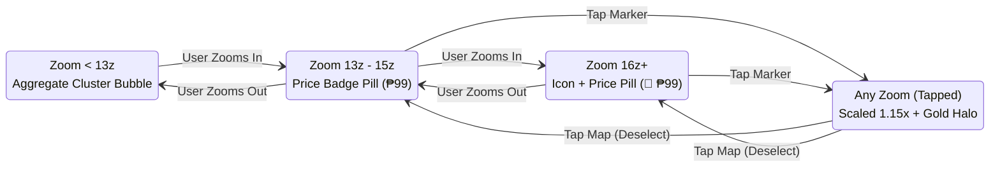

# NearBites — Design System & Visual Specification

> **Document Status**: CANONICAL DESIGN SPECIFICATION (Baseline v1.0)  
> **Target Platform**: React Native (iOS & Android)  
> **Design Philosophy**: Food-First, Price-Forward, Warm & Accessible  
> **Brand Mascot**: The Neighborhood Eagle Food Scout ([`assets/mascot.jpg`](file:///Users/ronalbert/Personal%20Projects/NearBites/docs/assets/mascot.jpg))  
> **Primary Anchor**: Deep Teal (`#325B53`) • **Accent**: Warm Gold (`#D8964B`) • **Canvas**: Cream (`#F5EBD7`)

---

## Table of Contents

1. [Design Foundations & Design Tokens](#1-design-foundations--design-tokens)
   - [Color Palette & Contrast Ratios](#11-color-palette--contrast-ratios)
   - [Typography Scale & Hierarchies](#12-typography-scale--hierarchies)
   - [Spacing & Layout Grid Scale](#13-spacing--layout-grid-scale)
   - [Elevation, Shadows & Surface Tokens](#14-elevation-shadows--surface-tokens)
   - [Touch Target Standards (≥ 44×44 pt)](#15-touch-target-standards--4444-pt)
2. [Map Marker Specifications & Zoom States](#2-map-marker-specifications--zoom-states)
   - [Zoom Level State Machine](#21-zoom-level-state-machine)
   - [Visual Layout & ASCII Schematics](#22-visual-layout--ascii-schematics)
3. [Bottom Sheet Wireframe & Layout Specifications](#3-bottom-sheet-wireframe--layout-specifications)
   - [Peek State Wireframe (~200dp)](#31-peek-state-wireframe-200dp)
   - [Expanded State Wireframe (85% Height)](#32-expanded-state-wireframe-85-height)
4. [Component Primitives Specification](#4-component-primitives-specification)
   - [Budget Filter Chips](#41-budget-filter-chips)
   - [Meal Cards (Grid & Horizontal Variant)](#42-meal-cards-grid--horizontal-variant)
   - [Price Freshness Badges](#43-price-freshness-badges)
   - [Buttons & Form Controls](#44-buttons--form-controls)
5. [Mascot Integration & UI Illustration Guidelines](#5-mascot-integration--ui-illustration-guidelines)
6. [Accessibility & Inclusive Design Standards](#6-accessibility--inclusive-design-standards)
7. [Asset & Media Pipeline Specifications](#7-asset--media-pipeline-specifications)

---

## 1. Design Foundations & Design Tokens

NearBites uses a tactile, warm culinary aesthetic inspired by authentic neighborhood food markets and Philippine food culture. The UI avoids sterile corporate blues or generic pure grays, using rich **Cream** backdrops, trusted **Deep Teal** anchors, and appetizing **Warm Gold** highlights.

### 1.1 Color Palette & Contrast Ratios

All core color combinations have been verified to exceed **WCAG 2.1 Level AA** minimum contrast ratios (4.5:1 for body copy, 3.0:1 for large display text and UI components).

| Token Name | Hex Code | RGB | Semantic Role | Contrast vs. Cream (`#F5EBD7`) | Contrast vs. White (`#FFFFFF`) |
| :--- | :--- | :--- | :--- | :---: | :---: |
| `color-brand-primary` | `#325B53` | `rgb(50, 91, 83)` | Primary brand anchor, primary CTA button, active navigation tab, trusted chrome | **4.84:1** (Pass AA) | **5.45:1** (Pass AA) |
| `color-brand-accent` | `#D8964B` | `rgb(216, 150, 75)` | Discovery highlights, price badges, active filter pill indicator, Warm Aging status | **1.62:1** *(decorative / background only)* | **1.82:1** *(decorative / background only)* |
| `color-surface-canvas` | `#F5EBD7` | `rgb(245, 235, 215)` | Primary app canvas background, modal sheet surfaces, card backing | — | 1.13:1 |
| `color-brand-warmth` | `#764323` | `rgb(118, 67, 35)` | Secondary brand warmth, cuisine tag borders, auxiliary buttons | **5.32:1** (Pass AA) | **5.98:1** (Pass AA) |
| `color-text-charcoal` | `#222A28` | `rgb(34, 42, 40)` | High-contrast primary body text, titles, iconography glyphs | **11.21:1** (Pass AAA) | **12.63:1** (Pass AAA) |
| `color-text-muted` | `#706E6B` | `rgb(112, 110, 107)` | Secondary metadata, distance indicators, timestamps, helper labels | **3.51:1** (Pass AA Large) | **3.95:1** (Pass AA Large) |
| `color-status-fresh` | `#3B7D68` | `rgb(59, 125, 104)` | Fresh price indicator (< 30 days), verified checkmarks, positive toasts | **3.22:1** (Pairs with icon/text) | **3.63:1** (Pairs with icon/text) |
| `color-status-warning` | `#C2410C` | `rgb(194, 65, 12)` | Stale price alerts (> 90 days), report buttons, critical validation errors | **4.68:1** (Pass AA) | **5.27:1** (Pass AA) |
| `color-surface-pure` | `#FFFFFF` | `rgb(255, 255, 255)` | Photo container backgrounds, input field backgrounds, high-contrast pills | 1.13:1 | — |
| `color-border-subtle` | `#E2D9CC` | `rgb(226, 217, 204)` | Card outlines, bottom sheet dividers, unselected pill borders | 1.25:1 (Subtle divider) | 1.41:1 |

> [!IMPORTANT]
> **No Status Communicated by Color Alone**: Wherever status is indicated (e.g., Fresh Green `#3B7D68` or Warning Red `#C2410C`), the element **MUST** be paired with an explicit icon (checkmark, clock, alert triangle) and an accessible textual label (e.g., "Verified 3 days ago").

---

### 1.2 Typography Scale & Hierarchies

NearBites utilizes **Outfit** for friendly, modern display headings and **Inter** for crisp, highly legible body text and numerical price displays. Tabular figures (`font-variant-numeric: tabular-nums`) are enforced across all monetary values to prevent jitter during filtering or animation.

| Hierarchy Token | Font Family | Size | Weight | Line Height | Letter Spacing | Use Case |
| :--- | :--- | :---: | :---: | :---: | :---: | :--- |
| `font-display` | Outfit | 32pt | Bold (700) | 40pt | -0.5pt | Splash screens, empty state headline |
| `font-heading-1` | Outfit | 24pt | SemiBold (600) | 30pt | -0.3pt | Meal title in Expanded Sheet, Venue Name |
| `font-heading-2` | Outfit | 20pt | SemiBold (600) | 26pt | -0.2pt | Bottom sheet section titles, Saved tab title |
| `font-heading-3` | Inter | 16pt | Bold (700) | 22pt | 0.0pt | Meal title in Peek Sheet (~200dp) |
| `font-body-large` | Inter | 16pt | Regular (400) | 24pt | 0.0pt | Explanatory copy, permission body |
| `font-body` | Inter | 14pt | Regular (400) | 20pt | 0.0pt | Standard card text, venue addresses |
| `font-caption` | Inter | 12pt | Medium (500) | 16pt | +0.2pt | Distance badges, timestamps, helper labels |
| `font-price-badge` | Inter | 14pt | Bold (700) | 18pt | -0.2pt | **Tabular numbers** on map markers (`₱99`) |
| `font-price-hero` | Inter | 22pt | Bold (700) | 28pt | -0.4pt | Formatted price on Peek/Expanded sheet |

---

### 1.3 Spacing & Layout Grid Scale

The spacing scale is built on a strict **4pt base increment**:

| Token | Dimension | Common Application |
| :--- | :---: | :--- |
| `space-1` | 4pt | Icon-to-text gap, badge internal padding |
| `space-2` | 8pt | Internal padding of chips, gaps between metadata tags |
| `space-3` | 12pt | Gap between list items, card internal margin |
| `space-4` | 16pt | Standard screen horizontal margin, bottom sheet content padding |
| `space-5` | 20pt | Separation between sections within Expanded Sheet |
| `space-6` | 24pt | Top handle clearance, modal margin |
| `space-8` | 32pt | Top spacing above primary CTAs, empty state padding |
| `space-12` | 48pt | Bottom padding clearance above navigation bar |
| `space-16` | 64pt | Mascot hero container height |

---

### 1.4 Elevation, Shadows & Surface Tokens

Shadows use a soft Warm Charcoal tint (`rgba(34, 42, 40, 0.12)`) rather than harsh cold black, giving card layers a natural, warm depth.

| Elevation Level | Token Name | Elevation / Shadow Parameters | Used On |
| :--- | :--- | :--- | :--- |
| **Level 0** | `elevation-flat` | `shadowColor: 'transparent'` | Screen canvas, divider lines |
| **Level 1** | `elevation-card` | `offset: (0, 2), blur: 6, opacity: 0.08` | Saved meal cards, horizontal food scroll cards |
| **Level 2** | `elevation-floating` | `offset: (0, 4), blur: 10, opacity: 0.14` | Budget filter chips, current location button |
| **Level 3** | `elevation-sheet` | `offset: (0, -4), blur: 16, opacity: 0.16` | Peek & Expanded Bottom Sheet container |
| **Level 4** | `elevation-modal` | `offset: (0, 8), blur: 24, opacity: 0.22` | Progressive Auth Modal, Reporting Modal |

---

### 1.5 Touch Target Standards (≥ 44×44 pt)

In strict accordance with mobile accessibility guidelines (Apple HIG and Android Material), **every interactive element** must have a minimum physical hit target of **44×44 pt**, even if the visual container is smaller:

```
+-------------------------------------------------------+
|  Invisible Hit Target Box (Minimum 44 x 44 pt)        |
|                                                       |
|       +---------------------------------------+       |
|       |  Visual Filter Chip (36 pt height)    |       |
|       |  e.g., "≤ ₱150"                       |       |
|       +---------------------------------------+       |
|                                                       |
+-------------------------------------------------------+
```

---

## 2. Map Marker Specifications & Zoom States

The map marker is the primary entry point to food discovery. Because NearBites is **Price-First**, markers always present numerical prices rather than abstract restaurant pins.

### 2.1 Zoom Level State Machine



---

### 2.2 Visual Layout & ASCII Schematics

#### State A: Low Zoom (< 13z) — Aggregate Cluster Bubble
Groups high-density meal locations into a single count bubble to maintain 60fps rendering and avoid clutter.

```
       +------------------+
       |   (18 meals)     |  <- Background: Deep Teal (#325B53)
       |       ● 18       |  <- Text: White (#FFFFFF), 13pt Bold
       +--------+---------+  <- Ring Border: 2pt Warm Gold (#D8964B)
                V            <- Drop shadow: Level 2
```

#### State B: Medium Zoom (13z–15z) — Price Badge Pill
Reveals the exact starting meal price at each physical location.

```
        +----------------+
        |     ₱99        |  <- Background: Pure White (#FFFFFF)
        +-------+--------+  <- Border: 1.5pt Deep Teal (#325B53)
                V           <- Text: Deep Teal (#325B53), 14pt Bold Tabular
                            <- Height: 32pt (Hit Target: 44x44pt)
```

#### State C: High Zoom (16z+) — Category Icon + Price Pill
Reveals the meal category glyph alongside the price tag for instant visual comprehension at street walking level.

```
        +--------------------+
        |  🍜   ₱120         |  <- Background: Pure White (#FFFFFF)
        +---------+----------+  <- Border: 1.5pt Deep Teal (#325B53)
                  V             <- Icon: Category Emoji / Glyph (14pt)
                                <- Text: Deep Teal (#325B53), 14pt Bold Tabular
```

#### State D: Selected / Active Marker State (Any Zoom)
Tapping any marker transitions it to the **Selected State**. The marker scales up by **1.15x**, inverts its background to Deep Teal with a bold Warm Gold border and prominent pointing stem, and remains anchored above the Peek Bottom Sheet.

```
        +======================+
        |                      |
        |   🍜  ₱120           |  <- Background: Deep Teal (#325B53)
        |                      |  <- Border: 2.5pt Warm Gold (#D8964B)
        +==========+===========+  <- Text: Pure White (#FFFFFF) + Gold Accent
                   |              <- Scale: 1.15x
                   V              <- Elevation: Level 3 Shadow
```

---

## 3. Bottom Sheet Wireframe & Layout Specifications

The transition from Map Marker to Bottom Sheet is the central performance and UX benchmark of NearBites.

### 3.1 Peek State Wireframe (~200dp Height)

Tapping a marker snaps the sheet to Peek State in **< 200ms**. The user absorbs all 5 essential decision criteria (Photo, Name, Price, Venue, Distance) in under 1–2 seconds without scrolling.

```
+-----------------------------------------------------------------------+
|                              [  ---  ]  <- 32x4pt Drag Affordance     |
|                                                                       |
|  +--------------------+   Crispy Pork Sisig w/ Rice                   |
|  |                    |   Ate Fe's Kitchen • 180m (3 min walk)        |
|  |     1:1 PHOTO      |                                               |
|  |    THUMBNAIL       |   +-----------+  +-------------------------+  |
|  |     96x96 pt       |   |   ₱99     |  |  GET DIRECTIONS    ->   |  |
|  |  (Radius: 12pt)    |   +-----------+  +-------------------------+  |
|  +--------------------+   (Warm Gold)    (Primary CTA: Deep Teal)     |
|                                                                       |
+-----------------------------------------------------------------------+
```

#### Peek State Field Hierarchy & Sizing
1. **Top Drag Affordance**: Rounded pill `32×4 pt`, color `#E2D9CC`, centered 8pt from top edge.
2. **Food Photo Thumbnail**: Exactly `96×96 pt`, 1:1 aspect ratio, `border-radius: 12pt`. Cached memory thumbnail displayed instantaneously.
3. **Meal Title**: `16pt Bold Outfit`, Charcoal (`#222A28`), strictly clamped to max 2 lines with ellipsis truncation.
4. **Venue & Proximity Subtitle**: `13pt Regular Inter`, Muted Text (`#706E6B`). Format: `{Venue Name} • {Distance in m/km}`.
5. **Price Pill**: Large formatted price (`₱99`), Warm Gold background (`#D8964B`) with Charcoal bold text (`16pt`), padding `6×10 pt`.
6. **Primary Direction CTA**: `44pt` height button, Deep Teal background (`#325B53`), White bold text (`14pt`), right-aligned icon `->`.

---

### 3.2 Expanded State Wireframe (85% Height)

Dragging the sheet upward expands the view to **85% screen height**, revealing rich community trust signals, freshness badges, and additional dishes.

```
+-----------------------------------------------------------------------+
|  [ < Back ]               Crispy Pork Sisig             [ Heart ] [Share]
+-----------------------------------------------------------------------+
|                                                                       |
|  +-----------------------------------------------------------------+  |
|  |                                                                 |  |
|  |             16:9 HIGH-RESOLUTION HERO PHOTO CAROUSEL            |  |
|  |                         (Radius: 16pt)                          |  |
|  |                                                                 |  |
|  +-----------------------------------------------------------------+  |
|                                [ •  o  o ]  <- Pagination Dots        |
|                                                                       |
|  Crispy Pork Sisig w/ Rice                           ₱99              |
|  Filipino • Sizzling Rice Meal                    (Bold 22pt)         |
|                                                                       |
|  +-----------------------------------------------------------------+  |
|  | [✓] Verified 3 days ago by Community Scout                      |  |
|  +-----------------------------------------------------------------+  |
|  | [ Confirm Price Still Valid ]    [ Suggest Price Correction ]   |  |
|  +-----------------------------------------------------------------+  |
|                                                                       |
|  WHERE TO EAT THIS                                                    |
|  Ate Fe's Kitchen                                                     |
|  1248 Concepcion St, Ermita, Manila • 180m away                       |
|  [● Open Now] Closes at 9:00 PM                                       |
|                                                                       |
|  +-----------------------------------------------------------------+  |
|  |              [ GET TURN-BY-TURN DIRECTIONS ]                    |  |
|  +-----------------------------------------------------------------+  |
|                                                                       |
|  MORE BUDGET MEALS AT ATE FE'S KITCHEN                                |
|  +---------------------+   +---------------------+   +-------------+  |
|  | [Photo]             |   | [Photo]             |   | [Photo]     |  |
|  | Tokwa't Baboy       |   | Lugaw w/ Egg        |   | Mami Soup   |  |
|  | ₱65                 |   | ₱45                 |   | ₱55         |  |
|  +---------------------+   +---------------------+   +-------------+  |
|                                                                       |
|  [ ! Report an Issue with this Listing ]                              |
|                                                                       |
+-----------------------------------------------------------------------+
```

---

## 4. Component Primitives Specification

### 4.1 Budget Filter Chips

Budget chips sit horizontally beneath the top search bar. They scroll horizontally with snap points and provide 1-tap price filtering.

```
[ All Meals ]   [ ≤ ₱99 ]   [ ≤ ₱150 ]   [ ≤ ₱250 ]   [ ⚙ Custom... ]
```

| State | Background Color | Border Style | Text Color & Weight | Shadow |
| :--- | :--- | :--- | :--- | :--- |
| **Default (Unselected)** | Pure White (`#FFFFFF`) | 1pt solid `#E2D9CC` | Charcoal (`#222A28`), 14pt Medium | Level 1 |
| **Active (Selected)** | Deep Teal (`#325B53`) | 1pt solid `#325B53` | Pure White (`#FFFFFF`), 14pt SemiBold | Level 2 |
| **Disabled** | Cream (`#F5EBD7`) | 1pt dashed `#E2D9CC` | Muted Text (`#706E6B`), 14pt Regular | None |

- **Minimum Dimensions**: Height `36pt`, horizontal padding `14pt`. Hit area padded to `44×44pt`.
- **Border Radius**: Fully rounded pill shape (`border-radius: 9999px`).

---

### 4.2 Meal Cards (Grid & Horizontal Variant)

Used across the **Saved** tab (2-column responsive grid) and **Expanded Bottom Sheet** (horizontal carousel).

```
+------------------------------------+
| +--------------------------------+ |
| |                                | |  <- Food Photo (16:10 ratio)
| |          FOOD PHOTO            | |  <- Radius: 10pt
| |                                | |
| +--------------------------------+ |
|                                    |
| Crispy Pork Sisig                  |  <- 14pt SemiBold Outfit
| Ate Fe's Kitchen                   |  <- 12pt Muted Inter
|                                    |
| ₱99                     • 180m     |  <- Price (Warm Gold), Distance (Muted)
+------------------------------------+
```

---

### 4.3 Price Freshness Badges

Freshness badges reinforce trust and community accuracy. Every badge pairs a semantic color token with an explicit icon and descriptive copy:

```
[✓] Verified 3 days ago        [⏰] Confirmed 2 months ago      [⚠] Price may have changed
    (Fresh Green)                     (Warm Gold)                      (Charcoal / Muted)
```

| Freshness Tier | Threshold | Token | Background | Icon Glyph | Text Copy |
| :--- | :--- | :--- | :--- | :---: | :--- |
| **Fresh** | Verified `< 30 days` ago | `color-status-fresh` | `#3B7D68` (12% tint) | Checkmark `[✓]` | *"Verified {N} days ago"* |
| **Aging** | Verified `30–90 days` ago | `color-brand-accent` | `#D8964B` (14% tint) | Clock `[⏰]` | *"Confirmed {N} months ago"* |
| **Stale** | Verified `> 90 days` ago | `color-text-charcoal` | `#222A28` (10% tint) | Warning `[⚠]` | *"Price may have changed • Verify"* |

---

### 4.4 Buttons & Form Controls

- **Primary Button**: Deep Teal (`#325B53`) fill, White text, `48pt` height, `12pt` corner radius, Level 2 shadow.
- **Secondary / Accent Button**: Warm Gold (`#D8964B`) fill, Charcoal text, `44pt` height.
- **Outline Button**: Transparent background, `1.5pt` solid Deep Teal border, Deep Teal text.
- **Destructive Button**: Warning Red (`#C2410C`) text on transparent or 10% red tint background.

---

## 5. Mascot Integration & UI Illustration Guidelines

The NearBites mascot is **the Neighborhood Eagle Food Scout** wearing aviator goggles and presenting a steaming bowl of affordable food ([`assets/mascot.jpg`](file:///Users/ronalbert/Personal%20Projects/NearBites/docs/assets/mascot.jpg)). 

```
Approved Placements & Microcopy:
-------------------------------------------------------------------------------------
1. Empty Viewport (Budget too low)
   Illustration: Mascot looking puzzled at an empty bowl.
   Headline:     "No meals found under ₱100 nearby"
   Body:         "Our scout couldn't spot any dishes at this price in this area. 
                 Try bumping your budget slider or exploring another street!"
   CTA Button:   "Reset to Under ₱150"

2. Location Permission Explainer
   Illustration: Mascot adjusting his aviator goggles and pointing forward.
   Headline:     "Good food is closer than you think"
   Body:         "Allow NearBites to access your location so our scout can find 
                 hot, affordable meals within walking distance."
   CTA Button:   "Find Food Near Me"

3. Offline / Interrupted Network
   Illustration: Mascot holding a pocket compass.
   Headline:     "You're off the grid!"
   Body:         "We can't fetch new prices without internet. Showing dishes 
                 previously loaded in this neighborhood."
   CTA Button:   "Try Reconnecting"

4. Community Contribution Confirmation
   Illustration: Mascot saluting with a steaming rice bowl.
   Headline:     "Salamat, Food Scout!"
   Body:         "Your meal submission is in review. Thanks for helping your 
                 neighbors discover authentic, affordable eats."
   CTA Button:   "Back to the Map"
-------------------------------------------------------------------------------------
```

---

## 6. Accessibility & Inclusive Design Standards

### 6.1 Contrast Verification Matrix

| Element Pair | Foreground Color | Background Color | Measured Ratio | WCAG Compliance |
| :--- | :--- | :--- | :---: | :---: |
| Primary Body Copy | Charcoal (`#222A28`) | Cream (`#F5EBD7`) | **11.21:1** | Pass AAA |
| Primary CTA Text | Pure White (`#FFFFFF`) | Deep Teal (`#325B53`) | **5.45:1** | Pass AA |
| Price Badge Text | Charcoal (`#222A28`) | Warm Gold (`#D8964B`) | **6.91:1** | Pass AAA |
| Fresh Status Badge | White (`#FFFFFF`) | Fresh Green (`#3B7D68`) | **4.68:1** | Pass AA |
| Muted Metadata Text | Charcoal 60% (`#706E6B`)| Cream (`#F5EBD7`) | **3.51:1** | Pass AA Large (≥14pt bold/18pt reg) |

### 6.2 Dynamic Type & Font Scaling Rules
- All text styles must use relative scaling units (`allowFontScaling={true}` in React Native).
- Text containers must support dynamic type expansion up to **200%** without text clipping or truncated prices.
- Numbers on price badges must never break across multiple lines: always use `numberOfLines={1}` with tabular numerals.

### 6.3 Screen Reader Accessibility Tokens

Every interactive component must include explicit accessibility properties:

```tsx
// Example Map Marker Component Spec
<Pressable
  accessible={true}
  accessibilityRole="button"
  accessibilityLabel={`Meal: ${meal.title}, Price: ₱${meal.price}, at ${restaurant.name}`}
  accessibilityHint="Double tap to open meal details and photos"
  hitSlop={{ top: 8, bottom: 8, left: 8, right: 8 }}
>
  <PriceBadge price={meal.price} />
</Pressable>
```

---

## 7. Asset & Media Pipeline Specifications

To guarantee the **1–2 second photo-first discovery benchmark**, the media pipeline enforces strict image caching and size constraints:

### 7.1 Image Sizes & Formats

| Asset Type | Max Dimensions | Target Size | Format | Client Cache Policy |
| :--- | :---: | :---: | :---: | :--- |
| **Map Marker Thumbnail** | 96×96 px | < 15 KB | WebP / JPEG | Persistent Disk Cache (LRU 50MB) + Memory Cache |
| **Peek Sheet Image** | 300×300 px | < 45 KB | WebP / JPEG | Preloaded upon marker tap |
| **Expanded Hero Carousel** | 1200×675 px (16:9) | < 180 KB | WebP / JPEG | Lazy loaded upon sheet drag upward |
| **User Upload Submission** | 1600×1600 px (max) | < 500 KB | WebP (quality 80%) | Compressed client-side before upload |

### 7.2 Image Loading Fallback Hierarchy
1. **Preload**: When marker is tapped, request Peek thumbnail immediately.
2. **Skeleton**: If image takes > 150ms to render, display a warm cream skeleton shimmer.
3. **Category Placeholder**: If network fails or returns 404, display category glyph (e.g., 🍜 for noodles, 🍗 for chicken) with "Tap to retry".
