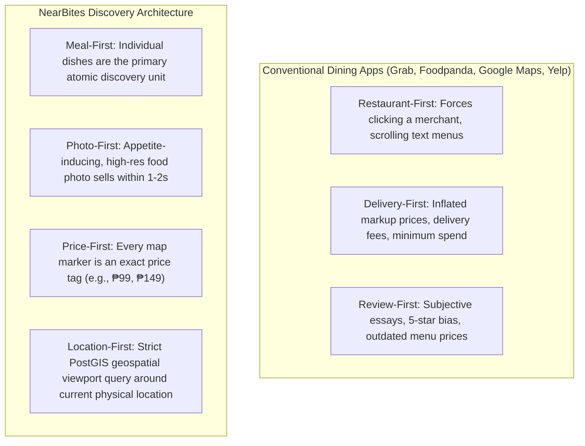
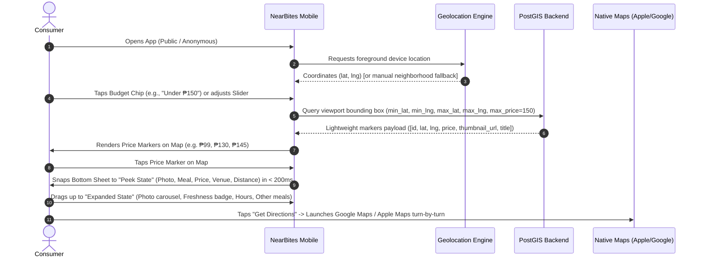
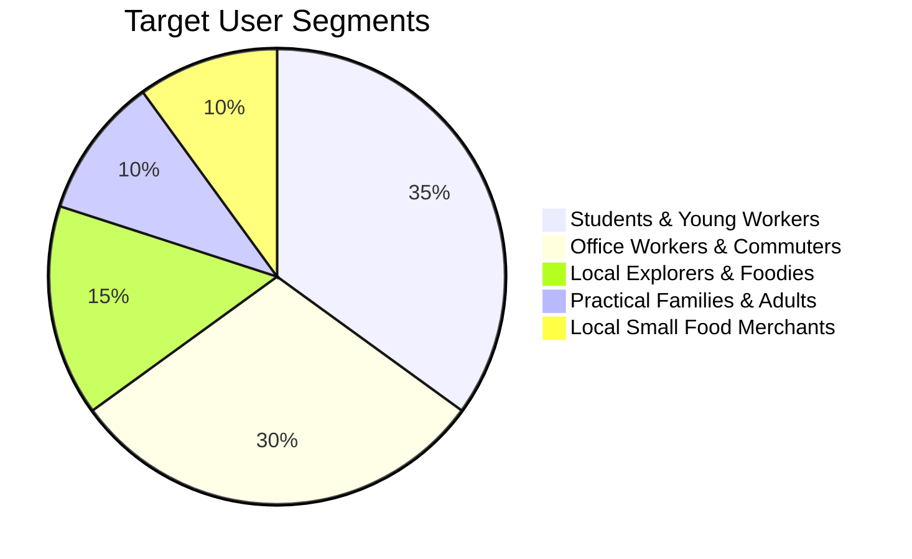
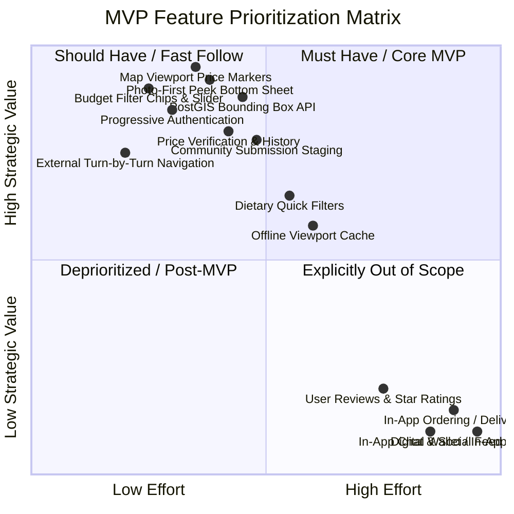
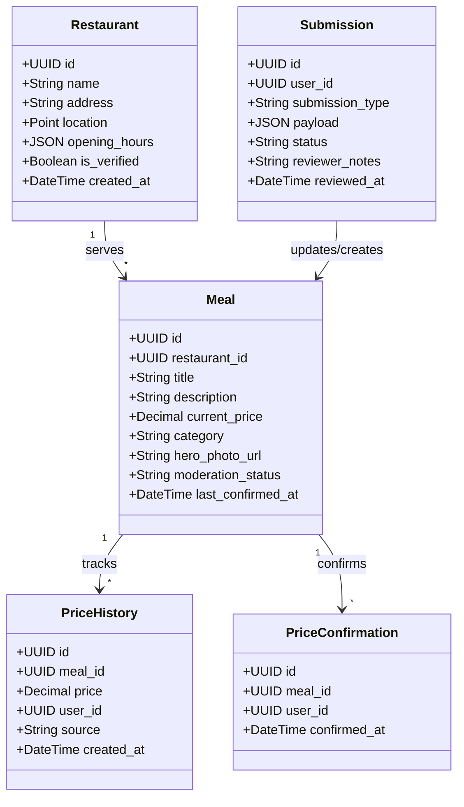
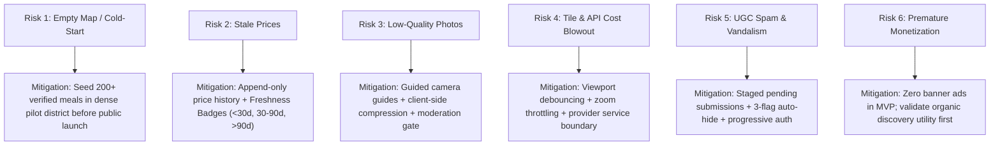

# NearBites — Canonical Product Requirements Document (PRD)

> **Document Status**: CANONICAL SPECIFICATION (Baseline v1.0)  
> **Release Target**: Mobile MVP (iOS & Android)  
> **Initial Launch Market**: Urban Centers of the Philippines (Metro Manila / High-Density Student & Office Hubs)  
> **Tagline**: *"Good food is closer than you think."*  
> **Functional Promise**: *"Real food. Real prices. Nearby."*  
> **Primary Platform**: React Native / Expo (Cross-Platform Mobile App)  
> **Backend & Geospatial**: Supabase (PostgreSQL + PostGIS, Auth, Storage, Edge Functions)

---

## Table of Contents

1. [Executive Summary, Mission, Vision & Value Proposition](#1-executive-summary-mission-vision--value-proposition)
2. [Brand Identity, Visual Design Tokens & Mascot Guidelines](#2-brand-identity-visual-design-tokens--mascot-guidelines)
3. [Target Personas & Jobs to Be Done (JTBD)](#3-target-personas--jobs-to-be-done-jtbd)
4. [Scope Boundaries & Strict MoSCoW Matrix](#4-scope-boundaries--strict-moscow-matrix)
5. [Functional Requirements (FR-01 to FR-16) & System Rules](#5-functional-requirements-fr-01-to-fr-16--system-rules)
6. [Non-Functional Requirements (NFR-01 to NFR-10)](#6-non-functional-requirements-nfr-01-to-nfr-10)
7. [Exhaustive User Stories & Gherkin Acceptance Criteria (US-01 to US-09)](#7-exhaustive-user-stories--gherkin-acceptance-criteria-us-01-to-us-09)
8. [High-Level Analytics Event Taxonomy](#8-high-level-analytics-event-taxonomy)
9. [Risk Register & Operational Mitigations](#9-risk-register--operational-mitigations)
10. [MVP Definition of Done (DoD)](#10-mvp-definition-of-done-dod)

---

## 1. Executive Summary, Mission, Vision & Value Proposition

### 1.1 What We Are Building

**NearBites** is a mobile-first, meal-centric food discovery application built specifically for budget-conscious diners in urban centers of the Philippines. 

The core human question NearBites answers in under 5 seconds is:
> **"What can I eat near me within my budget?"**

Conventional dining platforms fail budget-conscious food seekers because they are architecturally biased toward high-margin transactions:



### 1.2 Core Product Loop

The core user experience is friction-free, requiring zero onboarding tutorials or account creation to discover food:



### 1.3 Mission and Vision

- **Mission**: Make good, affordable local food easier to discover by showing people what they can actually eat, what it costs, and where to find it.
- **Vision**: Become the everyday food discovery map for local communities, helping people discover great meals nearby while giving small, authentic food businesses visibility regardless of their marketing budget or brand size.

### 1.4 Value Proposition Matrix

| Dimension | Conventional Platforms (Google Maps, Grab, Yelp) | NearBites |
| :--- | :--- | :--- |
| **Discovery Unit** | The Restaurant / Merchant Entity | The Specific Meal / Dish |
| **Visual Trigger** | Restaurant storefront or user-uploaded chaotic photo dump | Clean, mouth-watering hero food photo displayed upfront |
| **Price Transparency** | Hidden inside multi-page PDF menus or inflated delivery pricing | Exact in-store dine-in / take-out price visible on map marker |
| **Budget Control** | Filter by arbitrary price ratings (`$`, `$$`, `$$$`) | Filter by exact Philippine Peso ceiling (e.g., ₱100, ₱150, ₱250) |
| **Browsing Friction** | Requires sign-in, location prompts, ad banners | Instant anonymous discovery; auth only upon write actions |
| **Small Eateries Support** | Invisible unless heavily rated or paying ad dollars | Equal discovery surface: an incredible ₱85 *pares* ranks equally |

---

## 2. Brand Identity, Visual Design Tokens & Mascot Guidelines

### 2.1 Brand Name & Identity Attributes

- **Brand Name**: NearBites
- **Tagline**: *"Good food is closer than you think."*
- **Functional Promise**: *"Real food. Real prices. Nearby."*
- **Brand Purpose**: Make local food more visible.
- **Brand Personality**: Friendly, curious, local, practical, warm, trustworthy, and lightly playful.

### 2.2 Design System Tokens

NearBites uses a tailored color palette that emphasizes appetizing warmth, legible high contrast, and trusted verification.

| Token Name | Hex Code | Semantic Role | Accessibility (WCAG AA) |
| :--- | :--- | :--- | :--- |
| **Deep Teal** | `#325B53` | Primary brand anchor, primary navigation, selected active states, trusted chrome | Contrasts 4.8:1 against Cream surfaces |
| **Warm Gold** | `#D8964B` | Accent color, key highlights, discovery chips, price callouts, "Aging" status | High vibrancy on dark and light surfaces |
| **Cream** | `#F5EBD7` | Warm canvas background, card surfaces, modal sheets | Soft warm tint reducing eye fatigue |
| **Cocoa Brown** | `#764323` | Secondary brand anchor, food warmth elements, secondary button borders | Deep earthy tone conveying culinary authenticity |
| **Charcoal** | `#222A28` | Primary text, high-contrast headings, icon glyphs, dark outlines | Contrasts 11.2:1 against Cream; crisp readability |
| **Fresh Green** | `#3B7D68` | Verification badges, "Fresh" price indicator (<30d), success toasts | Pairs with checkmark glyph for positive status |
| **Warning Red** | `#C2410C` | Stale alerts, report triggers, destructive confirmation actions | Clear functional warning (never used alone) |

### 2.3 Typography & Surface Rules

- **Display & Headings**: Inter / Outfit (Modern geometric sans-serif with rounded, friendly terminals).
- **Body & Numerical Values**: Inter (tabular numerals enabled for prices: `font-variant-numeric: tabular-nums`).
- **Minimum Touch Targets**: 44×44 pt on all touch devices.
- **Price Presentation**: Standardized to Philippine Peso symbol with no decimals for whole amounts: `₱99`, `₱150`, `₱220`.

### 2.4 Mascot Usage Guidelines


The NearBites mascot is **an adventurous Philippine eagle food scout** wearing aviator goggles with a subtle national emblem strap, presenting a simple steaming bowl of local food. 

#### Mascot Purpose
The mascot personifies the local neighborhood scout who has done the footwork to find hidden, affordable culinary gems. It creates an approachable, memorable, and warm brand experience.

#### Approved Placements
1. **First-Time App Launch / Onboarding**: Welcoming the user to their local neighborhood.
2. **Empty Discovery State**: When no meals match a restrictive budget filter (holding an empty bowl with encouraging advice to raise the budget slider).
3. **Location Permission Explainer**: Friendly helper explaining why foreground location enables finding food within walking distance.
4. **Offline / Network Interruption**: Holding a compass with a retry action.
5. **Submission Milestone Confirmation**: Celebrating a user’s approved or submitted meal contribution.

#### Strictly Prohibited Placements
- **NEVER** place the mascot on top of the interactive map viewport as a decorative layer.
- **NEVER** replace or overlay meal photos with mascot illustrations in the bottom sheet.
- **NEVER** use the mascot as a replacement for real data status indicators (e.g., price badges).
- **NEVER** distort, recolor, or modify the aviator goggles or steaming bowl elements.

---

## 3. Target Personas & Jobs to Be Done (JTBD)

### 3.1 Persona Profiles



#### 1. Student / Young Worker (e.g., "Mark", 20, Manila University Belt)
- **Context**: Daily allowance is strictly limited (₱150–₱250/day for food). Between classes or study sessions, needs an immediate, filling meal without spending time walking into sit-down places only to find prices are out of reach.
- **Pain Points**: Food delivery apps charge ₱60+ delivery fees on a ₱100 meal. Google Maps doesn't list the *carinderia* across the alley or the exact price of a *silog*.
- **JTBD**: *When I only have ₱120 left in my pocket between classes, I want to see actual hot meals I can afford within a 5-minute walk, so I can eat a satisfying lunch without overspending or walking aimlessly.*

#### 2. Office Worker (e.g., "Sarah", 27, Ortigas / BGC Business District)
- **Context**: 1-hour lunch break. Fatigued by recurring overpriced fast-food chains or delivery queues. Wants variety, decent nutrition, and fast turnaround under ₱180.
- **Pain Points**: Standard food blogs promote expensive cafes; food delivery takes 45 minutes to arrive cold.
- **JTBD**: *When my lunch break starts and I am tired of fast-food value meals, I want to quickly spot affordable rice bowls or healthy options nearby with confirmed current prices, so I can walk over, eat well, and return to work on time.*

#### 3. Local Explorer & Budget Foodie (e.g., "Paolo", 24, QC Neighborhoods)
- **Context**: Loves uncovering hidden neighborhood eateries, street food, night markets, and authentic regional dishes. Enjoys sharing budget finds with friends.
- **Pain Points**: Mainstream review sites are dominated by sponsored western franchises. Local stalls have zero online presence.
- **JTBD**: *When I am exploring a new neighborhood, I want to see real dish photos uploaded by locals with up-to-date prices, so I can discover hidden spots that are easy to miss on generic maps and share them with my community.*

#### 4. Practical Family / Budget Adult (e.g., "Elena", 38, Suburban Pasig)
- **Context**: Managing a household budget. Needs reliable, family-friendly meal stops or takeout during errand runs without surprise costs.
- **Pain Points**: Arriving at an eatery only to find the menu prices have doubled since a 2021 photo review.
- **JTBD**: *When I am running weekend errands with my child, I want to know the verified price and physical distance to nearby meal spots, so I can make a reliable decision without stress or budget shocks.*

#### 5. Local Food Merchant / Carinderia Owner (e.g., "Mang Jun", 49, Eatery Owner)
- **Context**: Serves delicious, home-style *lutong bahay* at ₱75–₱120 per serving. Has zero digital marketing budget and cannot afford 25%–30% commissions on delivery platforms.
- **Pain Points**: Potential walk-in customers walk past every day without knowing what is cooking or that lunch costs under ₱100.
- **JTBD**: *When I cook fresh, affordable dishes daily, I want nearby workers and students to see my meals and prices when they are hungry nearby, so I can increase daily foot traffic without paying punishing commissions.*

---

## 4. Scope Boundaries & Strict MoSCoW Matrix



### 4.1 Must Have (MVP Baseline)
1. **Foreground Geolocation & Manual Search Fallback**: Fast GPS lock with fallback to neighborhood/street search if permission denied.
2. **Geospatial Viewport Meal Marker Rendering**: Bounding box queries on PostGIS (`GIST` index) fetching lightweight marker payloads.
3. **Dynamic Marker Clustering**: Smooth clustering at low zoom levels, expanding into numerical price badges (e.g. `₱99`, `₱150`) at street zoom.
4. **Instant Budget Filtering**: Horizontal quick-select chips (`All`, `≤ ₱99`, `≤ ₱150`, `≤ ₱250`) and custom interactive price slider.
5. **Photo-First Bottom Sheet**:
   - **Peek State (~200dp)**: Food photo, dish name, price tag, venue name, distance (meters/km). Rendered within < 200ms.
   - **Expanded State**: High-res photo gallery, price freshness status badge, venue operating hours, other budget dishes at venue.
6. **Native Navigation Launcher**: Deep-link one-tap trigger into Apple Maps (iOS) or Google Maps (Android).
7. **Progressive Authentication**: 100% anonymous browsing and map exploration; modal login triggered only on write/save actions.
8. **Personal Favorites List**: Save/unsave meal bookmarks synced to user account.
9. **Community Meal & Venue Submissions**: Multi-step submission form with client-side image compression; staged in `pending` moderation queue.
10. **Append-Only Price Integrity**: Price confirmation ("Confirm Price Still Valid") and price correction flows that log historical records in `price_history`.
11. **Price Freshness Indicators**: Explicit categorization:
    - **Fresh**: Verified < 30 days ago (Fresh Green `#3B7D68` + Checkmark badge)
    - **Aging**: Verified 30–90 days ago (Warm Gold `#D8964B` + Clock badge)
    - **Stale**: Verified > 90 days ago (Charcoal/Muted + Alert badge + "Verify this price" CTA)
12. **Content Reporting**: Flag inappropriate photos, wrong prices, closed restaurants, or duplicate entries.
13. **Native Sharing**: One-tap share generating universal deep links.
14. **Administrative Moderation Gateway**: Backend API/interface to approve, reject, or edit community submissions.

### 4.2 Should Have (Fast Follow / Post-Pilot Launch)
- **Dietary Tags**: Quick toggle for Halal, Vegetarian, Pork-Free.
- **Basic Viewport Offline Cache**: Retain last viewed bounding box in local SQLite storage for subway/basement viewing.
- **Dark Mode Map Styling**: Map tile theme switching aligned with device dark mode settings.

### 4.3 Could Have (Post-Validation Enhancements)
- **Contributor Badges**: Lightweight badges for top community scouts (e.g., "Ermita Scout").
- **Custom User Collections**: Allowing users to group saved meals into custom folders (e.g., "Breakfast Spot", "Cheat Day").
- **Merchant Claim Verification Flow**: Self-service portal for shop owners to claim official badges.

### 4.4 Explicitly Out of Scope for MVP
> [!CAUTION]
> The following features are strictly prohibited during MVP implementation. Any introduction of these features represents uncontrolled scope creep and will be rejected at the Quality Gate:
- **In-App Food Ordering & Delivery Logistics**: NearBites is a discovery and foot-traffic engine, not a courier service.
- **Table Reservations**: No booking engines or seat allocation logic.
- **In-App Digital Wallets & Payments**: Zero credit card processing, GCash/Maya in-app payment gateways, or split billing.
- **Private User-to-User Messaging**: No chat or direct communication channels.
- **Social Follower Graph & Creator Feeds**: No profile follows, status updates, or social walls.
- **Multi-Star Ratings & Essay Reviews**: No 1-to-5 star rating systems or subjective long-form complaint reviews. NearBites relies on objective photos, exact prices, and freshness dates.
- **Gamification Currency / Reward Points**: No crypto tokens, redeemable points, or virtual currencies.
- **AI Chatbots / Conversational Assistants**: Discovery is visual, map-driven, and instant; not conversation-based.
- **Self-Serve Paid Advertising Tools**: No auction ad manager; organic relevance must be validated first.
- **International Expansion**: Strictly focused on the Philippine urban market.

---

## 5. Functional Requirements (FR-01 to FR-16) & System Rules



### Detailed Functional Specifications

- **FR-01 (Location & Fallback)**:
  - System requests foreground GPS permission on first interactive launch with a contextual explainer.
  - If granted, map centers on current device coordinates at street zoom level (15z–16z).
  - If denied or restricted, system displays a non-blocking toast, defaults to a high-density pilot neighborhood center (e.g., University Belt, Manila), and opens a manual search bar for immediate area lookup.
- **FR-02 (Viewport-Constrained Querying)**:
  - Mobile client sends bounding box coordinates (`min_lat`, `min_lng`, `max_lat`, `max_lng`) upon map pan/zoom idle.
  - Database queries records matching `ST_MakeEnvelope(min_lng, min_lat, max_lng, max_lat, 4326)` using PostGIS spatial indexing.
  - Payload per marker is capped to lightweight attributes: `{id, meal_id, title, price, lat, lng, thumbnail_url, freshness_tier}`.
- **FR-03 (Clustering & Progressive Zoom)**:
  - Low zoom (< 13z): Markers cluster into aggregate numeric bubbles showing cluster count.
  - Mid zoom (13z–15z): Clustered markers expand into standalone price pills (e.g., `₱99`).
  - High zoom (16z+): Price pills display alongside micro meal icons or category glyphs.
  - Active selection highlights the marker with Deep Teal background and Warm Gold border, scaling 1.15x.
- **FR-04 (Budget Filtering)**:
  - Top bar features horizontal budget pills: `All`, `≤ ₱99`, `≤ ₱150`, `≤ ₱250`, plus a slider button.
  - Tapping a pill instantly filters client markers and updates query parameters without reloading unaffected tiles.
  - Custom budget slider allows selecting any ceiling between ₱50 and ₱500 in ₱10 increments.
- **FR-05 (Photo-First Bottom Sheet)**:
  - Marker tap triggers bottom sheet to snap immediately to **Peek State (~200dp)**.
  - Peek State layout:
    - Left/Top: 1:1 Aspect ratio meal thumbnail (high-quality, preloaded cache).
    - Meal title (max 2 lines, Charcoal, bold).
    - Large formatted price badge (e.g., `₱120`, Warm Gold text on Deep Teal pill).
    - Venue name and walking distance (e.g., "Mang Inasal • 250m").
    - Action trigger: "Get Directions" button + drag affordance bar.
- **FR-06 (Meal Detail Expanded State)**:
  - User can drag bottom sheet to **Expanded State (85% screen height)**.
  - Layout:
    - Full-width hero photo carousel with dot indicator.
    - Dish name, category, and verified price.
    - Price freshness indicator badge with exact last-confirmed date ("Verified 3 days ago").
    - "Confirm Price" and "Report Correction" community buttons.
    - Venue section: Full address, distance, opening hours status (Open now / Closed), and other budget meals served here.
- **FR-07 (Venue Detail View)**:
  - Tapping venue name from bottom sheet displays the venue sheet containing all approved meals for this eatery sorted by price ascending, along with venue exterior photos.
- **FR-08 (Debounced Search)**:
  - Universal search input debounced at 300ms.
  - Supports tripartite search:
    1. Meal title (e.g., "Pork Sisig", "Chicken Inasal")
    2. Category / keyword (e.g., "Silog", "Noodles", "Halal")
    3. Neighborhood / Street (e.g., "España Blvd", "BGC")
- **FR-09 (External Turn-by-Turn Navigation)**:
  - Tapping "Get Directions" prompts native OS handler:
    - iOS: `maps://?daddr=lat,lng&dirflg=w` (Apple Maps)
    - Android: `google.navigation:q=lat,lng&mode=w` (Google Maps)
    - Fallback: `https://www.google.com/maps/dir/?api=1&destination=lat,lng`
- **FR-10 (Progressive Authentication)**:
  - The app never gates browsing, searching, or navigation behind a registration screen.
  - Auth modal is invoked conditionally when an unauthenticated user attempts:
    - Save to favorites
    - Confirm a price
    - Submit a price correction
    - Submit a new meal or restaurant
    - Submit an issue report
  - Upon successful auth, the pending action automatically completes without losing user context.
- **FR-11 (Favorites Management)**:
  - Authenticated users can tap heart icon to save meal to their "Saved" tab.
  - Displays as a responsive 2-column photo grid sorted by date saved or proximity.
- **FR-12 (Community Meal & Venue Submissions)**:
  - Guided 4-step wizard:
    1. Venue selection (existing nearby venue or create new pin on map).
    2. Meal details (Dish title, category, price in PHP).
    3. Photo upload (Camera capture or gallery selection; client-side resized to max 1600px, compressed WebP/JPEG < 500KB).
    4. Review and Submit.
  - Submissions are assigned status `pending` and stored in `submissions` table awaiting moderator review.
- **FR-13 (Append-Only Price Integrity & Verification)**:
  - Authenticated users can tap:
    - `Confirm Price Still Valid`: Records timestamp in `price_confirmations`, updates `last_confirmed_at` on meal entity.
    - `Submit Price Correction`: User enters new price and optional photo proof. Inserts new record into `price_history` with status `pending_verification`.
- **FR-14 (Content Reporting)**:
  - Structured reporting sheet with predefined categories:
    - Price is wrong
    - Restaurant is permanently closed
    - Inappropriate / offensive photo
    - Duplicate dish or venue
    - Food is no longer served
  - Reaching report threshold (3 unique flags) temporarily hides the listing pending moderation.
- **FR-15 (Native Sharing)**:
  - Tapping share invokes system share sheet with universal link format: `https://nearbites.ph/meal/{meal_id}`.
- **FR-16 (Admin Moderation Gateway)**:
  - Administrative role permissions allowing moderation staff to:
    - View queue of pending submissions and reports.
    - Approve submission (automatically creating canonical meal/restaurant records).
    - Reject submission with structured reason codes.
    - Merge duplicate restaurant entities.

---

## 6. Non-Functional Requirements (NFR-01 to NFR-10)

| ID | Category | Requirement & Exact Quantitative Standard |
| :--- | :--- | :--- |
| **NFR-01** | **Usability** | The core discovery loop (open app -> tap budget -> see meal on map -> open bottom sheet) must be intuitive and successfully completed by first-time users within 5 seconds without tutorial popups. |
| **NFR-02** | **Accessibility** | All interactive targets must have minimum dimensions of 44×44 pt. All text combinations must meet WCAG 2.1 AA standards (minimum contrast ratio of 4.5:1 for body, 3:1 for large text). Support dynamic type scaling up to 200%. Never communicate status via color alone: always combine color with iconography and text labels. |
| **NFR-03** | **Performance** | Map panning and bottom sheet drag gestures must sustain 60fps on mid-tier mobile hardware (e.g., iPhone 11, Samsung Galaxy A52). Viewport bounding-box queries must debounce at 300ms. Marker count per viewport throttled to maximum 75 pins via clustering. Thumbnails must load in < 400ms on 4G connections. |
| **NFR-04** | **Reliability** | Zero unhandled fatal exceptions. All network and hardware failures (offline, weak GPS, image fetch failure) must present graceful, informative states with retry options. Client must support offline viewing of currently loaded viewport. |
| **NFR-05** | **Security** | Zero privileged backend keys (such as Supabase service-role keys) in client binary. Strict PostgreSQL Row Level Security (RLS) policies enforcing that users can only modify their own draft contributions and favorites. All user text inputs sanitized against script injection and XSS. |
| **NFR-06** | **Privacy & Compliance** | Geolocation tracking restricted strictly to foreground active discovery sessions; continuous background location tracking is forbidden. Full compliance with the Philippine Data Privacy Act of 2012 (RA 10173) and Apple/Google Privacy Guidelines. Clear Privacy Policy and Terms of Service available in-app. |
| **NFR-07** | **Scalability** | PostGIS database queries constrained by `GIST(location)` spatial indexes. Average viewport query execution time under 80ms on database tier for datasets up to 100,000 meal records. |
| **NFR-08** | **Maintainability** | 100% strict TypeScript mode (`"strict": true`, zero `any` types). Feature-driven folder architecture with clear separation of concerns (presentation, domain logic, API clients). Versioned database migrations. |
| **NFR-09** | **Observability** | Integrated crash reporting via Sentry capturing stack traces, device specs, and breadcrumbs. Product funnel analytics tracking core events in PostHog with zero PII. |
| **NFR-10** | **Quality Assurance** | Unit test code coverage > 80% on core business logic (price calculators, distance formatters, validation schemas). Automated component tests for bottom sheet states. End-to-end smoke tests for primary user journey. |

---

## 7. Exhaustive User Stories & Gherkin Acceptance Criteria (US-01 to US-09)

### US-01: Anonymous Discovery & Budget Map Filtering
**As a** hungry consumer with a limited budget,  
**I want to** open the app and filter meals by price on an interactive map without logging in,  
**So that** I can immediately find food I can afford nearby without friction.

```gherkin
Feature: Anonymous Discovery & Budget Map Filtering

  Scenario: User opens app and browses default viewport anonymously
    Given the user has installed NearBites and has not created an account
    When the user opens the application
    Then the interactive map is rendered full screen
    And the top search bar, budget filter chips, and location button are visible
    And no authentication modal or forced sign-up wall is presented
    And meal price markers within the current viewport are displayed on the map

  Scenario: User filters map markers by selecting a budget chip
    Given the map is displaying meal markers between ₱50 and ₱350
    When the user taps the "≤ ₱100" budget chip
    Then the "≤ ₱100" chip enters the active selected state with Deep Teal styling
    And all markers with prices strictly greater than ₱100 disappear from the map
    And only markers with prices ₱100 or less remain visible
    And marker clusters recalculate their aggregate counts within 300ms

  Scenario: User adjusts custom budget slider
    Given the user opens the custom budget modal
    When the user drags the slider to "₱140" and taps "Apply"
    Then the map viewport updates to show only meals with price <= ₱140
    And the custom budget button displays "≤ ₱140"

  Scenario: No meals match the selected budget in current viewport
    Given the user is viewing an area with no meals under ₱80
    When the user selects the "≤ ₱50" budget chip
    Then the map markers are cleared
    And an informative banner appears showing the Mascot holding an empty bowl
    And the banner displays "No meals found under ₱50 nearby. Try raising your budget or exploring a wider area."
    And a quick-action button "Reset to Under ₱150" is displayed
```

---

### US-02: Geolocation & Permission Handling
**As a** mobile user,  
**I want** NearBites to locate my current position or let me search an area manually,  
**So that** I can see food relative to where I am or where I plan to be.

```gherkin
Feature: Geolocation & Permission Handling

  Scenario: User grants foreground location permission
    Given the user launches NearBites for the first time
    When the OS prompts for location permission
    And the user selects "While Using the App"
    Then the app acquires the device latitude and longitude
    And the map smoothly animates to center on the user coordinates at zoom level 16
    And a pulsing blue location indicator marks the user's position
    And nearby affordable meals load into the viewport

  Scenario: User denies location permission
    Given the user launches NearBites for the first time
    When the OS prompts for location permission
    And the user selects "Don't Allow"
    Then the map centers on the default pilot neighborhood (e.g., University Belt, Manila)
    And a non-intrusive notification banner appears: "Location is off. Search an area manually to see nearby meals."
    And the search input receives focus with quick-pick chips for popular districts

  Scenario: User searches for a specific neighborhood manually
    Given the user is viewing the map with location disabled or searching a distant area
    When the user types "Kapitolyo, Pasig" into the search bar
    And selects "Kapitolyo, Pasig City" from the autocomplete suggestions
    Then the map camera animates to center on Kapitolyo coordinates
    And budget-appropriate meal markers for Kapitolyo are fetched and rendered
```

---

### US-03: Photo-First Meal Bottom Sheet
**As a** diner seeking appetizing food,  
**I want to** tap a price marker and immediately see a mouth-watering photo, price, and venue details,  
**So that** I can make a visual and practical dining decision within seconds.

```gherkin
Feature: Photo-First Meal Bottom Sheet

  Scenario: User taps a price marker to open Peek State
    Given multiple price markers are displayed on the map
    When the user taps on marker "₱99" for "Crispy Pork Sisig"
    Then the marker scales up by 1.15x and displays an active highlight border
    And the bottom sheet snaps to Peek State (height ~200dp) in under 200ms
    And the sheet displays the preloaded 1:1 food thumbnail image
    And the sheet displays meal title "Crispy Pork Sisig"
    And the sheet displays exact price "₱99"
    And the sheet displays venue name "Ate Fe's Kitchen"
    And the sheet displays walking distance (e.g., "180m • 3 min walk")
    And a primary button "Get Directions" is visible

  Scenario: User expands bottom sheet to inspect full details
    Given the bottom sheet is in Peek State for "Crispy Pork Sisig"
    When the user swipes the bottom sheet upward to Expanded State
    Then the bottom sheet expands to 85% of screen height
    And a high-resolution hero photo carousel becomes swipeable
    And the Price Freshness badge is displayed with status and confirmation timestamp
    And the venue operating hours status (e.g., "Open • Closes at 9:00 PM") is shown
    And a horizontal list of "Other meals at Ate Fe's Kitchen under ₱150" is displayed
    And buttons for "Confirm Price", "Report Correction", and "Share" are accessible

  Scenario: Meal image fails to load due to poor network
    Given the user taps a price marker under poor network conditions
    When the image asset fails to load within 3 seconds
    Then the image container displays a warm Cream background with a food category placeholder icon
    And an unobtrusive "Tap to retry photo" icon is displayed
    And all text, price, and navigation metadata render normally without blocking the user
```

---

### US-04: External Directions Launch
**As a** hungry consumer who has picked a meal,  
**I want to** tap a single button to launch turn-by-turn navigation in my preferred map app,  
**So that** I can easily walk or drive to the eatery.

```gherkin
Feature: External Directions Launch

  Scenario: User launches directions on an iOS device
    Given the user is viewing the meal detail sheet on an Apple device
    When the user taps "Get Directions"
    Then the app triggers the iOS native URL scheme `maps://?daddr={lat},{lng}&dirflg=w`
    And Apple Maps opens externally with walking directions pre-populated
    And an analytics event `directions_launched` is logged with platform "ios"

  Scenario: User launches directions on an Android device
    Given the user is viewing the meal detail sheet on an Android device
    When the user taps "Get Directions"
    Then the app triggers Android intent `google.navigation:q={lat},{lng}&mode=w`
    And Google Maps opens externally with walking directions pre-populated
    And an analytics event `directions_launched` is logged with platform "android"

  Scenario: Native navigation app is not installed
    Given neither Apple Maps nor Google Maps native apps are available
    When the user taps "Get Directions"
    Then the app falls back to opening the web browser with `https://www.google.com/maps/dir/?api=1&destination={lat},{lng}`
```

---

### US-05: Progressive Authentication Triggers & State Transitions
**As an** unregistered user enjoying the app,  
**I want to** browse freely and be prompted to sign in only when taking personal or community actions,  
**So that** I don't face artificial barriers to discovering food.

```gherkin
Feature: Progressive Authentication Triggers & State Transitions

  Scenario Outline: Protected action triggers progressive authentication modal
    Given the user is browsing anonymously without an authenticated session
    When the user attempts to <action>
    Then the action is paused in memory
    And an authentication modal sheet appears explaining the value of signing in
    And options for "Continue with Google", "Continue with Apple", and "Email Magic Link" are presented

    Examples:
      | action                         |
      | tap the favorite heart icon    |
      | tap "Confirm Price Still Valid"|
      | tap "Submit Price Correction"  |
      | tap "Add Meal / Restaurant"    |
      | tap "Report Issue"             |

  Scenario: User successfully completes progressive authentication
    Given the user was attempting to favorite a meal "Beef Pares" for ₱85
    And the authentication modal was presented
    When the user successfully signs in with Google
    Then the authentication modal automatically dismisses
    And the paused action executes automatically: "Beef Pares" is saved to Favorites
    And a confirmation toast appears: "Saved to your favorites!"
    And the user remains on the exact meal detail screen without interruption

  Scenario: User dismisses authentication modal without signing in
    Given the user triggered the authentication modal by tapping favorite
    When the user taps the "Close" button or swipes down the modal
    Then the modal closes
    And the meal remains unfavorited
    And the user remains on the previous browsing screen without error
```

---

### US-06: Favorites Management
**As an** authenticated user,  
**I want to** save meals to a personal list and access them later,  
**So that** I can easily revisit my favorite budget dining spots.

```gherkin
Feature: Favorites Management

  Scenario: Authenticated user saves a meal to favorites
    Given the user is authenticated
    And is viewing the meal detail sheet for "Chicken Adobo Rice"
    When the user taps the "Save" heart icon
    Then the heart icon animates to a solid Warm Gold state
    And the meal is added to the user's `favorites` database record
    And an analytics event `meal_favorited` is recorded

  Scenario: Authenticated user views their Saved meals tab
    Given the user has favorited 4 meals across different locations
    When the user navigates to the "Saved" bottom navigation tab
    Then a list of the 4 saved meals is displayed
    And each card displays the dish photo, title, verified price, and distance from current location
    And tapping any card opens the meal detail bottom sheet

  Scenario: Authenticated user removes a meal from favorites
    Given the user is viewing their Saved list
    When the user taps the active heart icon on "Chicken Adobo Rice"
    Then the item is removed from the Saved list with an "Undo" snackbar
    And the record is deleted from the `favorites` table
```

---

### US-07: Community Contribution & Submission Staging
**As a** passionate local eater,  
**I want to** submit a great budget meal and upload a photo,  
**So that** other diners can discover it while preserving data quality.

```gherkin
Feature: Community Contribution & Submission Staging

  Scenario: User submits a new meal with photo
    Given the user is authenticated and opens the "Add Meal" wizard
    When the user selects existing venue "Mang Larry's Isawan"
    And enters meal title "Special Isaw Platter"
    And sets price to "₱60"
    And attaches a clear photo taken via camera
    And taps "Submit for Verification"
    Then the client compresses the image to WebP under 500KB
    And uploads the image to Supabase storage bucket `submission_photos`
    And creates a record in `submissions` table with status `pending`
    And a celebration modal appears featuring the Mascot Scout: "Salamat! Your submission is in review."
    And the meal does NOT appear publicly on the map until approved by an administrator

  Scenario: User attempts to submit a meal with missing required fields
    Given the user is on the meal submission step
    When the user leaves the price field empty and taps "Submit"
    Then the submission is blocked
    And an inline validation error appears under the price field: "Please enter an exact price in Philippine Pesos (₱)"
```

---

### US-08: Price Freshness Indicators & Verification Logic
**As a** budget diner,  
**I want to** see how recently a price was verified and help confirm it,  
**So that** I can trust the prices shown and avoid awkward surprises when paying.

```gherkin
Feature: Price Freshness Indicators & Verification Logic

  Scenario Outline: System renders appropriate freshness tier based on verification date
    Given a meal has a `last_confirmed_at` timestamp of <days_ago> days in the past
    When the meal is rendered on the map and bottom sheet
    Then the freshness badge displays status "<status_label>"
    And the badge uses color token "<color_token>"
    And the badge displays icon "<icon_type>"

    Examples:
      | days_ago | status_label          | color_token    | icon_type |
      | 5        | Verified 5 days ago   | Fresh Green    | Checkmark |
      | 29       | Verified 29 days ago  | Fresh Green    | Checkmark |
      | 31       | Confirmed 1 month ago | Warm Gold      | Clock     |
      | 89       | Confirmed 2 mos ago   | Warm Gold      | Clock     |
      | 95       | Price may have changed| Charcoal/Muted | Alert     |
      | 150      | Needs price check     | Charcoal/Muted | Alert     |

  Scenario: Authenticated user confirms an existing price is still valid
    Given the user is authenticated and viewing a meal with status "Confirmed 1 month ago"
    When the user taps "Confirm Price Still Valid"
    Then a record is inserted into `price_confirmations` with the user ID and timestamp
    And the meal's `last_confirmed_at` timestamp is updated to current time
    And the badge transitions immediately to Fresh Green "Verified today"
    And a confirmation toast displays: "Thank you for keeping NearBites accurate!"

  Scenario: Authenticated user submits a price correction
    Given an authenticated user notices "Pork BBQ" is now ₱35 instead of ₱30
    When the user taps "Submit Price Correction"
    And enters new price "₱35"
    And submits the correction
    Then a record is appended to `price_history` preserving the old price ₱30 and new price ₱35
    And the correction is staged for moderation review
    And the current displayed price remains ₱30 until approved or multi-confirmed
```

---

### US-09: Content Reporting & Flagging
**As a** community member,  
**I want to** report incorrect prices, closed restaurants, or bad photos,  
**So that** NearBites remains clean, accurate, and trustworthy.

```gherkin
Feature: Content Reporting & Flagging

  Scenario: User flags a permanently closed restaurant
    Given an authenticated user is on the detail sheet of a restaurant that has closed
    When the user taps "Report an Issue"
    And selects reason "Restaurant is permanently closed"
    And adds optional comment "Storefront is empty and building is under renovation"
    And submits the report
    Then a record is created in the `reports` table with target type `restaurant`
    And a confirmation message appears: "Thanks for reporting. Our scouts will inspect this listing."

  Scenario: Automated temporary unpublishing upon threshold breach
    Given a meal has received 2 distinct reports for "Offensive or Inappropriate Photo"
    When a 3rd distinct user submits a report for "Offensive or Inappropriate Photo" on the same meal
    Then the meal record status is updated to `flagged_hidden`
    And the meal is immediately excluded from public viewport map queries
    And a priority alert is routed to the administrative moderation dashboard
```

---

## 8. High-Level Analytics Event Taxonomy

To ensure data-informed iteration without invading personal privacy, NearBites captures product funnel and performance metrics using PostHog. All events avoid PII and track user intent, discovery efficiency, and community health.

| Event Name | Trigger Moment | Payload Properties | Strategic Purpose |
| :--- | :--- | :--- | :--- |
| `app_opened` | Cold start or warm foregrounding | `session_id`, `has_location_perm`, `app_version`, `os` | Track Daily Active Users (DAU) and platform split |
| `location_permission_prompted` | System shows OS location prompt | `trigger_reason` ("initial_launch", "manual_tap") | Monitor permission funnel entry |
| `location_permission_result` | User grants or denies location | `status` ("granted", "denied", "restricted") | Measure location opt-in conversion |
| `budget_chip_selected` | User taps a preset budget pill | `selected_price_tier` ("100", "150", "250", "all") | Measure price sensitivity and common budget thresholds |
| `custom_budget_set` | User applies custom budget slider | `custom_max_price`, `previous_max_price` | Understand fine-grained budget preferences |
| `map_viewport_changed` | User finishes panning or zooming map | `min_lat`, `min_lng`, `max_lat`, `max_lng`, `zoom_level`, `marker_count` | Measure spatial discovery activity and query density |
| `marker_tapped` | User taps a price pin on the map | `meal_id`, `restaurant_id`, `price`, `zoom_level`, `distance_m` | Core engagement metric: interest in specific price/pin |
| `peek_sheet_viewed` | Bottom sheet snaps into Peek State | `meal_id`, `price`, `latency_ms` | Validate <200ms render SLA and peek engagement |
| `sheet_expanded` | User drags sheet to Expanded State | `meal_id`, `time_in_peek_ms` | Measure depth of interest beyond initial photo/price |
| `directions_launched` | User taps "Get Directions" | `meal_id`, `restaurant_id`, `platform` ("apple", "google", "web"), `distance_m` | **Primary North Star intent conversion event** |
| `auth_modal_triggered` | Auth required modal pops up | `trigger_action` ("favorite", "confirm_price", "submission", "report") | Track progressive auth trigger distribution |
| `auth_completed` | User successfully logs in | `auth_provider` ("google", "apple", "magic_link"), `trigger_action` | Track progressive auth completion rate |
| `meal_favorited` | User taps heart to save meal | `meal_id`, `price`, `distance_m` | Measure user affinity and bookmark intent |
| `meal_unfavorited` | User removes meal from favorites | `meal_id` | Monitor bookmark churn |
| `price_confirmed` | User taps "Confirm Price Still Valid" | `meal_id`, `days_since_last_confirmed` | Track community price hygiene contributions |
| `price_correction_submitted`| User submits new price for dish | `meal_id`, `old_price`, `new_price`, `has_photo_proof` | Track price change velocity and inflation data |
| `submission_started` | User enters contribution wizard | `submission_type` ("new_meal", "new_restaurant") | Track contribution top-of-funnel |
| `submission_step_completed` | User completes wizard step | `step_index`, `step_name` | Identify friction points in submission wizard |
| `submission_submitted` | User completes and submits form | `submission_id`, `has_photo`, `price` | Measure total community content additions |
| `content_reported` | User submits a flag/report | `target_type`, `target_id`, `reason_code` | Monitor ecosystem health and data quality risks |

---

## 9. Risk Register & Operational Mitigations



### Risk Assessment & Mitigation Matrix

| Risk ID | Description & Potential Impact | Likelihood | Impact | Detection Mechanism | Mitigation Strategy |
| :--- | :--- | :--- | :--- | :--- | :--- |
| **RSK-01** | **The Cold-Start / Empty Map Problem**<br>Users download the app, open the map in their neighborhood, find zero or very few markers, conclude the app is useless, and churn permanently. | High | Critical | Viewport query logging tracking percentage of queries returning `< 3` markers. | **Depth Before Breadth**: Launch strictly in a single, ultra-dense pilot district (e.g., University Belt Manila or Kapitolyo Pasig). Hand-curate and seed 200+ verified budget meals with high-resolution photos prior to public launch. Display clear pilot boundary messaging outside the launch zone. |
| **RSK-02** | **Stale or Inaccurate Prices**<br>Rapid local food inflation causes real prices to diverge from displayed app prices, leading to user disappointment and loss of trust. | High | Critical | Frequency of price reports and average days since `last_confirmed_at`. | **Freshness Tiers & One-Tap Verification**: Every meal explicitly shows its freshness date. Meals older than 90 days display a prominent "Needs price check" warning. Authenticated users are incentivized with simple 1-tap "Confirm Price" actions to update timestamps without typing. |
| **RSK-03** | **Low-Quality / Unappetizing Photos**<br>Community uploads blurry, dark, half-eaten, or misleading photos that degrade the photo-first discovery proposition. | High | High | Moderation queue rejection rate on image quality guidelines. | **Submission Camera Guidelines & Moderation**: Guided camera overlay prompting well-lit, centered dish framing. Mandatory staging in `pending` queue where photos must be approved by admin before appearing live. Fallback to clean category icons when photos fail quality standards. |
| **RSK-04** | **Map API & Tile Cost Blowouts**<br>High user panning activity triggers massive tile fetch volumes and geolocation API bills on Google Maps / Mapbox. | Medium | High | Daily API billing alerts and request telemetry per active user. | **Viewport Query Throttling & Abstraction**: 300ms debounce on all camera movement before issuing bounding box requests. Marker clustering limits rendered DOM/native nodes. Strict boundary abstraction layer isolating map vendor to allow zero-cost tile provider swaps if needed. |
| **RSK-05** | **UGC Spam & Competitor Vandalism**<br>Bad actors submit fake prices, duplicate spam venues, or inappropriate images. | Medium | High | Automated duplicate detection (lat/lng proximity + string similarity) and report velocity. | **Moderation Gateway & Progressive Auth**: All write operations require verified authentication. Submissions remain staged until reviewed. Any item receiving 3 independent reports is immediately hidden automatically pending manual review. |
| **RSK-06** | **Premature Monetization Degrading Trust**<br>Launching banner ads or sponsored pins too early annoys users and skews organic affordability rankings. | Low | Critical | User feedback, retention drops on ad introduction. | **Pure Discovery Baseline**: Zero banner ads or interstitial popups in MVP. Sponsored placements are deferred to post-MVP and will always be transparently badged without displacing top organic budget matches. |

---

## 10. MVP Definition of Done (DoD)

The NearBites MVP is complete and ready for controlled pilot distribution (iOS TestFlight & Android Internal App Sharing) only when every item in this checklist is verified and approved:

### 10.1 Product & Core Discovery
- [ ] New users can open the app and immediately discover meals on the map without creating an account or logging in.
- [ ] Foreground location permission works smoothly; denying location presents an immediate manual neighborhood search fallback.
- [ ] Map renders affordable meal markers dynamically based on the current bounding box without downloading the entire database.
- [ ] Budget quick chips (`≤ ₱100`, `≤ ₱150`, `≤ ₱250`) and custom price slider filter the visible markers instantly.
- [ ] Marker clustering cleanly groups dense pins at low zoom and expands into exact price tags at street zoom.
- [ ] Tapping a price marker opens the bottom sheet in **Peek State (~200dp)** in `< 200ms`, displaying photo, dish title, price, venue name, and distance.
- [ ] Pulling the bottom sheet up expands to **Expanded State (85% height)**, showing photo gallery, freshness badge, hours, and other venue dishes.
- [ ] Tapping "Get Directions" successfully opens Apple Maps on iOS and Google Maps on Android with destination pre-populated.

### 10.2 Trust, Moderation & Progressive Auth
- [ ] Browsing, filtering, and external directions launch require zero authentication.
- [ ] Attempting to favorite, confirm price, correct price, or submit new content presents the progressive auth modal.
- [ ] Authenticated users can save meals to the "Saved" tab and remove them at will.
- [ ] Community contributions (meal, venue, price, photo) are staged as `pending` and do NOT go live until approved.
- [ ] Price freshness badges correctly render:
  - `< 30 days`: Fresh Green (`#3B7D68`) + Checkmark badge
  - `30–90 days`: Warm Gold (`#D8964B`) + Clock badge
  - `> 90 days`: Charcoal/Muted + Alert badge + "Verify this price" CTA
- [ ] Authenticated users can 1-tap "Confirm Price Still Valid" to refresh the confirmation timestamp.
- [ ] Content reporting flow allows users to flag wrong prices, closed eateries, bad photos, and duplicates. Items with 3 flags auto-hide.

### 10.3 Engineering, Quality & Performance
- [ ] Codebase compiles cleanly under strict TypeScript (`"strict": true`, zero `any` declarations).
- [ ] PostGIS spatial queries use `GIST` indexes and execute in `< 80ms` on realistic data volumes.
- [ ] Zero secret API keys or Supabase service-role keys are bundled in the mobile client binary.
- [ ] Row Level Security (RLS) policies are active and verified on all PostgreSQL tables.
- [ ] Client image upload pipeline compresses images to WebP/JPEG `< 500KB` before transmitting to storage.
- [ ] App maintains 60fps scrolling and map panning on mid-tier reference devices.
- [ ] All interactive touch targets meet the 44×44 pt minimum size.
- [ ] Text and color tokens meet WCAG 2.1 AA contrast requirements.
- [ ] Sentry crash reporting and PostHog analytics capture core funnel events without PII.
- [ ] Pilot launch area (dense pilot district) is seeded with at least 200 verified, appetizing budget meals.
