# NearBites — UX Architecture & User Flows Specification

> **Document Status**: CANONICAL UX SPECIFICATION (Baseline v1.0)  
> **Release Target**: Mobile MVP (iOS & Android)  
> **Core Interaction**: Map Marker Selection → Photo-First Peek Bottom Sheet (< 200ms)  
> **Navigation Baseline**: 4-Tab Navigation Shell (`Map`, `Saved`, `Add`, `Profile`)

---

## Table of Contents

1. [Information Architecture & Navigation Hierarchy](#1-information-architecture--navigation-hierarchy)
2. [Complete User Journey Flowcharts (Flows 1 to 9)](#2-complete-user-journey-flowcharts-flows-1-to-9)
   - [Flow 1: Cold Start & Geolocation Permission Flow](#flow-1-cold-start--geolocation-permission-flow)
   - [Flow 2: Map Discovery & Budget Filtering Flow](#flow-2-map-discovery--budget-filtering-flow)
   - [Flow 3: Map Marker Selection to Bottom Sheet Flow](#flow-3-map-marker-selection-to-bottom-sheet-flow)
   - [Flow 4: Tripartite Search & Area Exploration Flow](#flow-4-tripartite-search--area-exploration-flow)
   - [Flow 5: Progressive Authentication Interception Flow](#flow-5-progressive-authentication-interception-flow)
   - [Flow 6: Favorites Management Flow](#flow-6-favorites-management-flow)
   - [Flow 7: Community Contribution Wizard Flow](#flow-7-community-contribution-wizard-flow)
   - [Flow 8: Price Freshness & Community Verification Flow](#flow-8-price-freshness--community-verification-flow)
   - [Flow 9: Content Reporting & Flagging Flow](#flow-9-content-reporting--flagging-flow)
3. [State Machine Specification for Map & Bottom Sheet](#3-state-machine-specification-for-map--bottom-sheet)
4. [Exhaustive Error & Recovery Matrix](#4-exhaustive-error--recovery-matrix)

---

## 1. Information Architecture & Navigation Hierarchy

NearBites is architected around an uncluttered 4-tab bottom navigation shell. Public food exploration is completely ungated. Secondary modalities, detailed meal views, and authentication are managed through non-intrusive bottom sheets and contextual overlays.

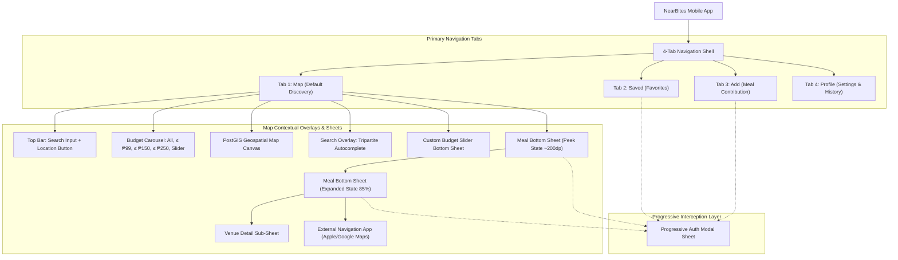

### 1.1 Primary Navigation Tabs

| Tab | Icon | Route | Access Level | Purpose |
| :--- | :--- | :--- | :--- | :--- |
| **Map** | Map Pin / Compass | `/ (index)` | Anonymous / Public | Primary discovery interface. Viewport map markers, budget filter chips, and photo-first bottom sheet. |
| **Saved** | Heart (Outline / Fill) | `/saved` | Protected (Progressive Auth) | List/grid of favorited meals. Prompts auth modal if anonymous user taps tab. |
| **Add** | Plus Circle | `/add` | Protected (Progressive Auth) | Multi-step community meal & restaurant submission wizard. Staged as pending. |
| **Profile** | User Avatar | `/profile` | Anonymous & Authenticated | Account preferences, submission history, price verification counter, legal/terms. |

### 1.2 Contextual Overlays & Modal Architecture

- **Search Overlay**: Floats over the map canvas when search bar is focused; shows recent queries, popular categories, and neighborhood suggestions.
- **Custom Budget Modal**: Bottom sheet modal providing a fine-grained price slider (`₱50` to `₱500` in `₱10` increments).
- **Meal Bottom Sheet (Peek State ~200dp)**: Non-blocking bottom sheet showing hero photo, dish title, price badge, venue name, distance, and one-tap "Get Directions".
- **Meal Bottom Sheet (Expanded State 85% height)**: Scrollable sheet showing multi-photo carousel, freshness indicator badge, operating hours, and other dishes at this eatery.
- **Progressive Auth Modal**: Slide-up sheet triggered when an anonymous user attempts a write action (Favorite, Verify, Submit, Report).
- **Content Reporting Sheet**: Structured modal to report incorrect prices, closed eateries, bad photos, or duplicate dishes.

---

## 2. Complete User Journey Flowcharts (Flows 1 to 9)

### Flow 1: Cold Start & Geolocation Permission Flow

Handles first-time launch, foreground permission requests, granting, and non-blocking recovery when permission is denied or restricted.

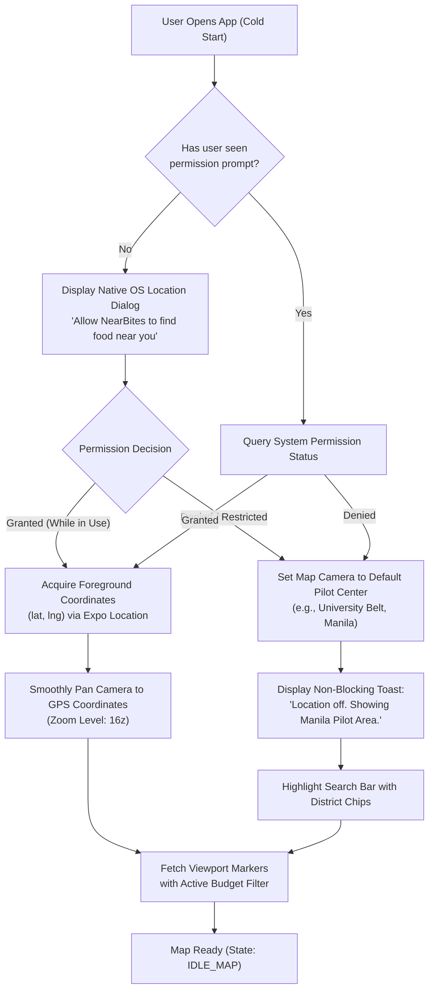

---

### Flow 2: Map Discovery & Budget Filtering Flow

Controls the interactive map canvas, 300ms query debouncing upon camera idle, marker clustering, and instant client/server budget filtering.

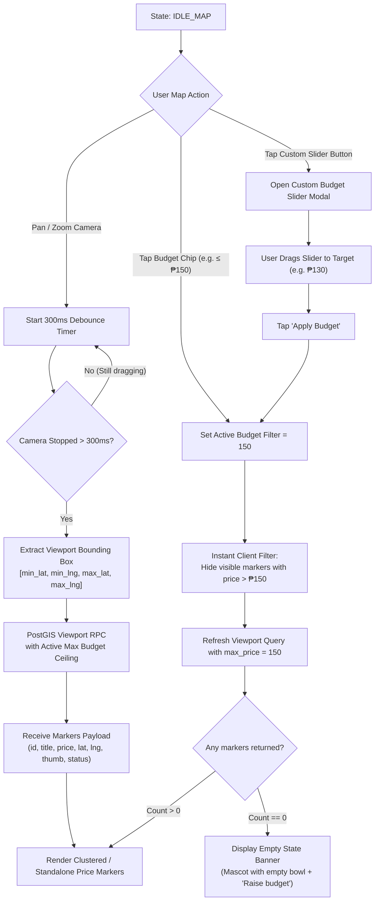

---

### Flow 3: Map Marker Selection to Bottom Sheet Flow

The core interaction of NearBites. Tapping a price pin snaps the bottom sheet to Peek State (~200dp) in under 200ms, positioning the camera so the pin remains visible.

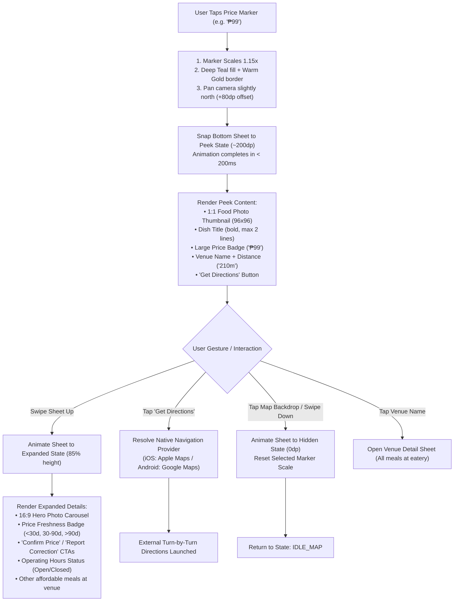

---

### Flow 4: Tripartite Search & Area Exploration Flow

Handles instant debounced search across three distinct entities: Meal Titles, Food Categories, and Neighborhoods/Streets.

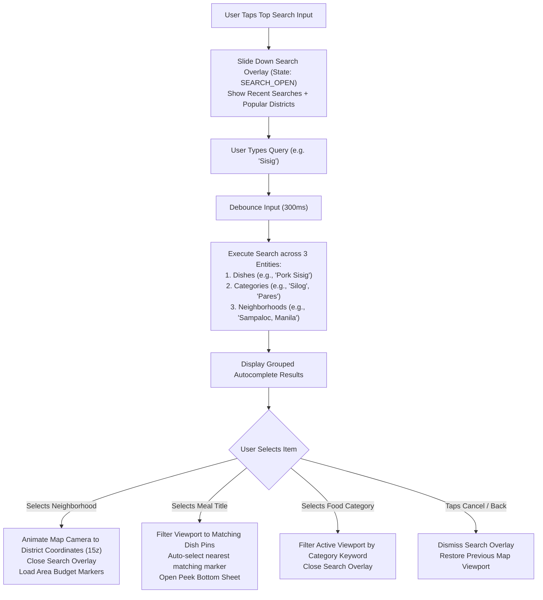

---

### Flow 5: Progressive Authentication Interception Flow

Allows 100% friction-free discovery. When an anonymous user attempts any write or bookmark action, the flow intercepts, preserves the pending action, authenticates, and resumes automatically.

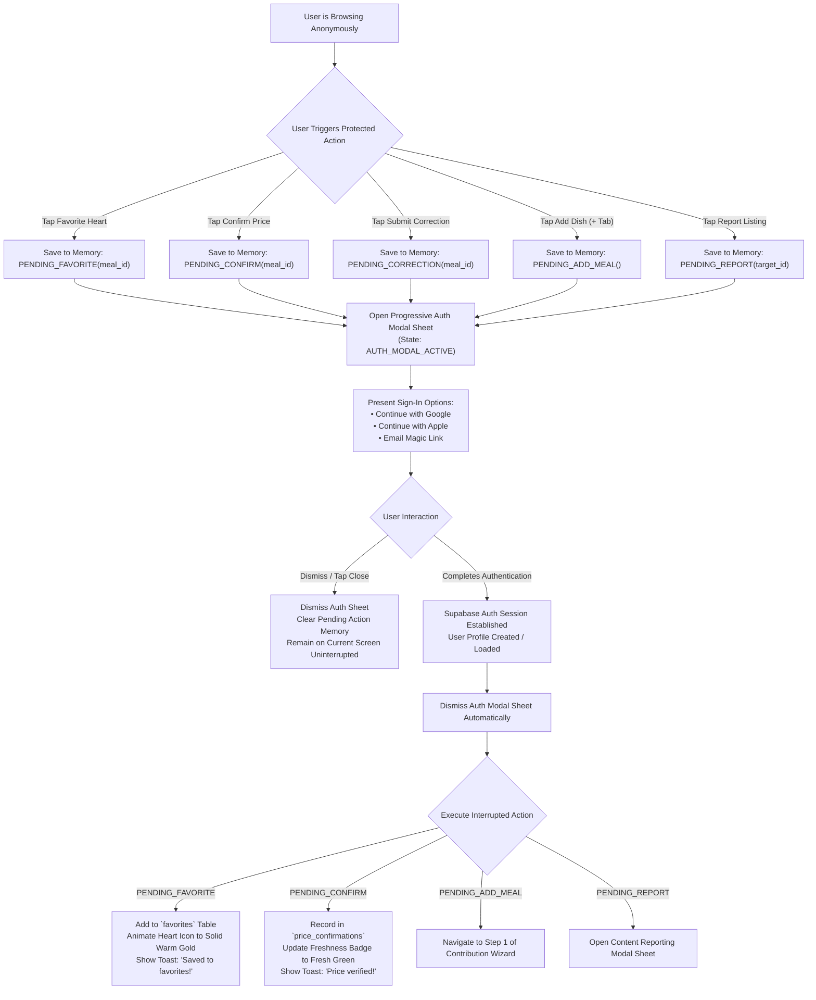

---

### Flow 6: Favorites Management Flow

Authenticated bookmark management accessible via the bottom navigation "Saved" tab.

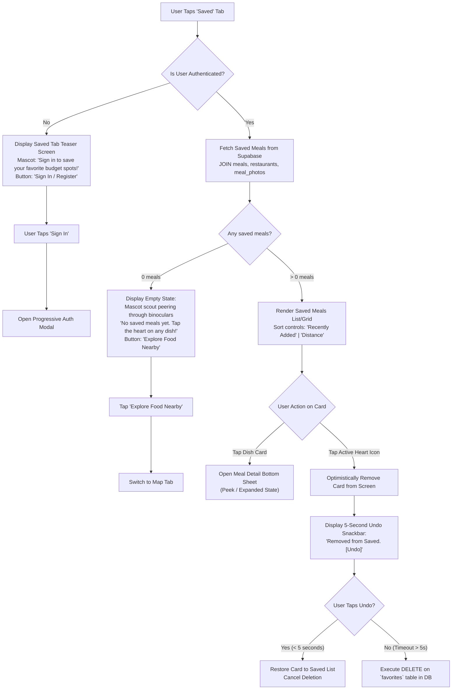

---

### Flow 7: Community Contribution Wizard Flow

Guided 4-step wizard to submit new meals and venues with camera integration, client-side compression (<500KB WebP), and staging into the `pending` moderation queue.

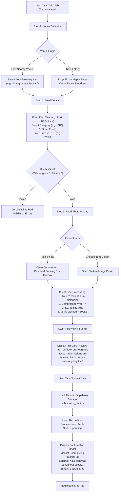

---

### Flow 8: Price Freshness & Community Verification Flow

Ensures price accuracy through lightweight community updates without destructive overwrites.

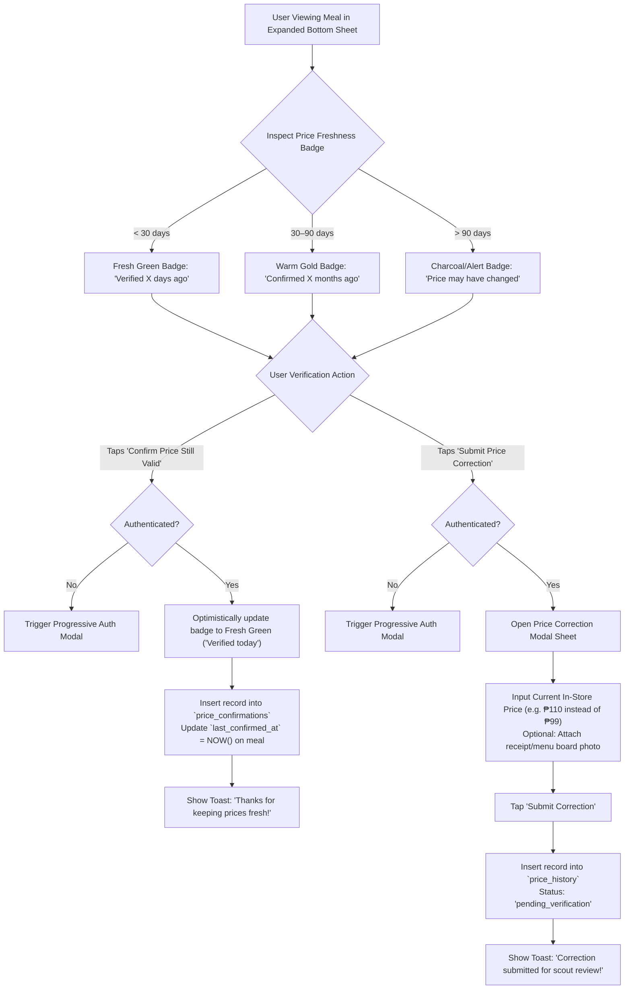

---

### Flow 9: Reporting & Content Flagging Flow

Community moderation system that protects content quality with automated temporary unpublishing upon reaching threshold.

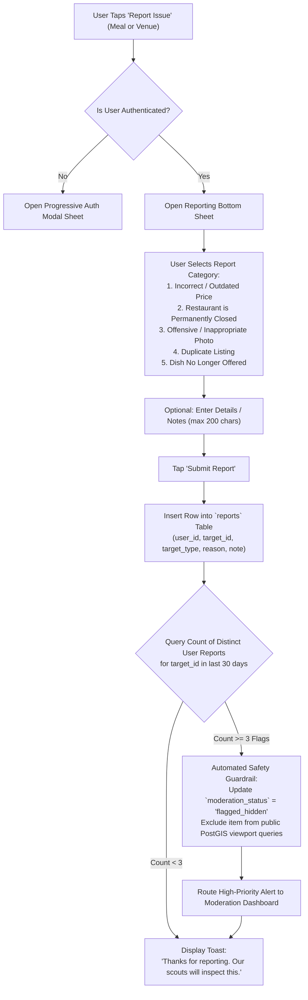

---

## 3. State Machine Specification for Map & Bottom Sheet

The core mobile experience coordinates map camera movements with bottom sheet gestures so that selected markers are never obscured by UI chrome.

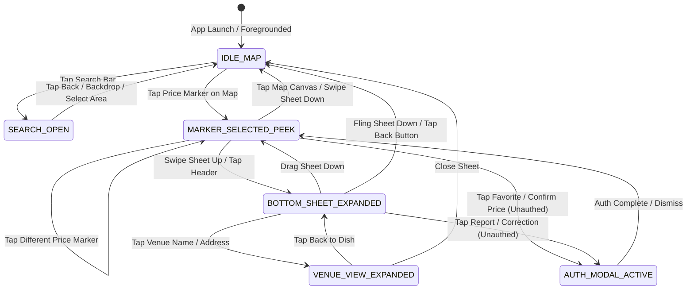

### 3.1 State Definitions & Camera Coordination

| State Name | Visible UI Chrome | Bottom Sheet Height | Camera Pan Behavior | Map Interactivity |
| :--- | :--- | :---: | :--- | :--- |
| **`IDLE_MAP`** | Search Bar, Budget Chips, Floating Location Button, Navigation Bar | `0dp` (Hidden) | Free user panning / zooming. | 100% interactive. Marker taps enabled. |
| **`MARKER_SELECTED_PEEK`** | Search Bar (dimmed), Budget Chips, Navigation Bar, Peek Bottom Sheet | `~200dp` (~25% screen) | **Auto-pan camera**: Centers selected marker coordinates with a `+80dp` vertical northward offset so marker stays visible above Peek Sheet. | Map behind sheet remains pan-able. Tapping another marker switches peek target. Tapping empty map dismisses sheet. |
| **`BOTTOM_SHEET_EXPANDED`** | Expanded Sheet Header with Back/Close affordance, full photo gallery, detail tabs | `85%` screen height | Map camera frozen. Map dimmed behind 40% Charcoal backdrop overlay. | Map touch disabled; gestures scroll sheet contents or collapse sheet. |
| **`VENUE_VIEW_EXPANDED`** | Venue Header, Exterior Photo, Full list of affordable meals at venue | `85%` screen height | Map camera frozen. | Scrollable list of meals; tapping any meal transitions back to meal detail. |
| **`SEARCH_OPEN`** | Search Input active with autofocus, Autocomplete suggestions, Recent chips | `100%` screen overlay | Camera remains at current position until suggestion selected. | Map occluded by search overlay. |
| **`AUTH_MODAL_ACTIVE`** | Modal sheet over dimmed screen, Social Auth buttons, Terms link | `~340dp` (Modal) | Camera frozen. | Map and underlying sheets touch-disabled until modal resolves. |

### 3.2 Gesture & Drag Thresholds

- **Peek to Expanded Transition**: Swiping upward with a velocity > `500dp/s` or dragging upward past `260dp` snaps sheet to `85%` height using Reanimated spring physics (`damping: 20`, `stiffness: 150`).
- **Expanded to Peek Transition**: Dragging downward from sheet top handle past `70%` screen height snaps back to `Peek State (~200dp)`.
- **Dismissal Threshold**: Dragging downward from Peek State past `120dp` or flinging downward with velocity > `600dp/s` dismisses the sheet completely (`0dp`), restoring `IDLE_MAP`.

---

## 4. Exhaustive Error & Recovery Matrix

| Scenario / Trigger | Entry Condition | System Action & Visual State | Error Indication | Recovery Path (User & System) |
| :--- | :--- | :--- | :--- | :--- |
| **Location Permission Denied** | User taps "Don't Allow" on OS prompt or permission restricted in settings. | Map centers on default pilot coordinate (Manila University Belt: `14.5995° N, 120.9842° E`). Non-blocking top snackbar appears. | Mascot icon with subtle text: *"Location off. Showing Manila Pilot area."* | 1. User can tap "Change Area" to open manual neighborhood search. 2. User can tap "Settings" on toast to open OS App Settings. |
| **Complete Offline / No Network** | Device loses WiFi and Cellular data connection during discovery. | Map displays cached map tiles. Bounding box query fails. Sticky offline banner slides down below budget bar. | Mascot Scout holding compass: *"You're offline. Showing previously loaded meals."* Offline banner `#222A28` with `#D8964B` text. | 1. System caches last successful viewport in local SQLite storage. 2. User can browse already-rendered markers. 3. Banner includes "Retry Connection" button that re-fires query when tapped. |
| **Weak / Intermittent Network** | Viewport query or bottom sheet detail request exceeds 5.0-second timeout. | Request aborts gracefully. Skeleton placeholders remain visible. Non-intrusive bottom snackbar displays. | Toast notification: *"Connection is sluggish. Tap to reload."* | 1. Auto-retry once with exponential backoff (1s delay). 2. If secondary retry fails, present explicit "Reload Meals" floating action pill over map. |
| **Zero Budget Matches in Viewport** | Active budget filter (e.g. `≤ ₱80`) yields 0 meals in currently visible bounding box. | All map markers disappear. A soft Cream card slides into the bottom viewport. | Mascot Scout presenting empty bowl: *"No meals found under ₱80 in this area."* | 1. Prominent primary button: *"Reset Budget to ≤ ₱150"*. 2. Secondary action: *"Explore Wider Area"* (automatically zooms out map by 2 zoom levels). |
| **Image Loading Failure** | Food photo fails to load (CDN 404, DNS failure, corrupted bytes). | Meal card / bottom sheet renders all text, price, venue, and distance data uninterrupted. | Image box displays warm Cream background (`#F5EBD7`) with a category glyph (e.g., 🍜 or 🍗) and subtle retry icon. | 1. User can tap the placeholder icon to retry fetching image asset. 2. App automatically falls back to secondary photo from `meal_photos` table if available. |
| **Progressive Auth Abandonment** | Anonymous user triggers auth modal (e.g. via Favorite), but swipes down or taps "X". | Auth modal sheet dismisses smoothly. Screen returns to exact previous state. | No error alert shown. Heart icon remains in unselected outline state. | 1. Interrupted action is discarded gracefully from memory. 2. User continues browsing without interruption or nag screens. |
| **Submission Upload Failure** | Network drops while uploading photo (>1MB) or inserting row into `submissions` table. | Upload progress bar halts. Form retains all user-typed inputs in local memory (Title, Price, Venue, Photo URI). | Red alert toast: *"Upload failed due to connection error. Your draft is saved."* | 1. "Retry Submission" button appears on Step 4. 2. Photo and inputs are cached in local draft storage so user never re-types data. |
